# ERD 안내

프로그램이 쓰는 SQLite DB의 표 구조와 설명입니다. 기능을 고치거나, 자료를 옮기거나, DB를 직접 들여다볼 때 봅니다. 읽는 분은 [기술 인수인계](../developer-guide.md)를 받는 개발자와 설치·운영 담당자입니다.

> 스키마 기준 2026-10-29 · 코드 `feature/p16-admin-settings` `61d4b9f`(P16 관리 설정 표 8개 추가) · 빈 DB에 `migrate`를 실행해 뽑은 실제 스키마와 대조했습니다: 표 48 · 인덱스 51 · 뷰 10 · 트리거 41

## 파일 구성

| 파일 | 내용 | 상태 |
|---|---|---|
| [document.md](document.md) | 문서·결재·생산일지·관리 설정 표 24개 — 영역별 그림 + 표마다 컬럼·키·제약·앱 규칙 | 끝 |
| [json.md](json.md) | JSON 칸 구조 — 양식 정의, 칸 값, 결재 스냅샷, 템플릿 덮어쓸 값, 변경 이력(관리 설정 이력 `admin_change_log`는 [document.md](document.md#admin_change_log)) | 끝 |
| [views.md](views.md) | 뷰 10개 — 문서 쪽이 수불을 읽는 `v_doc_*` 계약 4개와 수불 내부 뷰 | 끝 |
| [inventory.md](inventory.md) | 수불 표 22개 — 관계 그림(FK 37개) + 표마다 컬럼·키·제약·트리거·앱 규칙 | 초안 — **수불 담당 확인 전** |
| [schema.sql](schema.sql) | 실제 스키마 전체(표·인덱스·뷰·트리거 SQL) | 읽기용 |

나머지 2개는 Django 자체 표(`django_migrations`·`django_content_type`)입니다.

## 전체 그림

업무 표 46개(수불 22 · 문서 9 · 결재 3 · 생산일지 4 · 관리 설정 8)와 그 사이 FK 53개 전부입니다. 왼쪽이 문서·결재, 가운데 위가 생산일지 기준정보, 오른쪽이 수불입니다. 문서 영역은 `document_ref`(→ `lots`·`production_batches`·`items`)에서, 관리 설정은 `item_ccp`(→ `items`)·`batch_ccp_applied`(→ `production_batches`)에서 수불과 FK로 만납니다.

```mermaid
erDiagram
  approval ||--o{ approval_candidate : "approval_id"
  approval_request ||--o{ approval : "request_id"
  bom_lines ||--o{ bom_line_alternatives : "bom_line_id"
  bom_lines ||--o{ production_material_usages : "bom_line_id"
  boms ||--o{ bom_lines : "bom_id"
  boms ||--o{ production_batches : "bom_id"
  deviation_action ||--o{ deviation_checker : "deviation_id"
  doc_section ||--o{ deviation_action : "section_id"
  doc_section ||--o{ document_ref : "document_id, section_id"
  document ||--o{ approval_request : "document_id"
  document ||--o{ deviation_action : "document_id"
  document ||--o{ doc_section : "document_id"
  document ||--o{ document_correction : "document_id"
  document ||--o{ document_file : "document_id"
  document ||--o{ document_ref : "document_id"
  document ||--o{ master_change_log : "document_id"
  document_template ||--o{ approval_request : "template_id"
  document_template ||--o{ document : "template_id"
  file ||--o{ document_file : "file_id"
  hold_dispositions ||--o{ holds : "disposition"
  hold_source_types ||--o{ holds : "source_type"
  holds ||--o{ holds : "parent_hold_id"
  item_types ||--o{ items : "item_type"
  item_types ||--o{ lot_number_rules : "item_type"
  items ||--o{ bom_line_alternatives : "item_id"
  items ||--o{ bom_lines : "component_item_id"
  items ||--o{ boms : "item_id"
  items ||--o{ document_ref : "item_id"
  items ||--o| item_ccp : "item_id"
  items ||--o{ lots : "item_id"
  items ||--o{ production_batches : "item_id"
  lots ||--o{ document_ref : "lot_id"
  lots ||--o{ holds : "lot_id"
  lots ||--o{ incoming_receipts : "lot_id"
  lots ||--o{ inventory : "lot_id"
  lots ||--o{ inventory_purge_scope : "lot_id"
  lots ||--o{ production_material_usages : "lot_id"
  lots ||--o{ production_outputs : "lot_id"
  lots ||--o{ stock_movements : "lot_id"
  process ||--o{ process_template_step : "process_id"
  process_template ||--o{ process_template_step : "process_template_id"
  production_batches ||--o| batch_ccp_applied : "batch_id"
  production_batches ||--o{ document_ref : "production_batch_id"
  production_batches ||--o{ holds : "batch_id"
  production_batches ||--o{ production_material_usages : "batch_id"
  production_batches ||--o{ production_outputs : "batch_id"
  role_form ||--o{ role_form_member : "role_form_id"
  stock_movement_types ||--o{ stock_movements : "movement_type_code"
  stock_movements ||--o{ incoming_receipts : "stock_movement_id"
  stock_movements ||--o{ production_material_usages : "stock_movement_id"
  stock_movements ||--o{ production_outputs : "stock_movement_id"
  stock_movements ||--o{ stock_movements : "corrects_movement_id"
  suppliers ||--o{ incoming_receipts : "supplier_id"
```



- 사람(`staff`)으로 가는 FK 34개는 그림을 읽기 쉽게 하려고 뺐습니다. 문서·결재·생산일지·관리 설정·수불의 모든 사람 컬럼(`created_by`·`completed_by`·`staff_id`·`held_by`·`actor_id` …)이 `staff.id`를 가리킵니다.
- 컬럼은 그림에서 뺐습니다. 표마다의 컬럼과 영역별 확대 그림은 [document.md](document.md)·[inventory.md](inventory.md#관계-그림)에 있습니다.
- FK가 아니라 값으로만 잇는 곳: `holds.source_document_id` → `document.document_id`, 생산일지 공정 줄의 `process_id`(JSON 안), `role_form.type_code` → `document_template.type_code`, `admin_change_log.target_id`(대상 FK 없음), 문서 쪽이 수불을 읽는 `v_doc_*` 뷰([views.md](views.md)).
- `ccp_default`·`role_config`는 FK가 없는 단독 표라 그림에 없습니다.

| 영역 | 표 | 소유 앱 | 만드는 곳 | 설명 |
|---|---|---|---|---|
| 수불(입고·재고·생산) | 22 | `inventory` | SQL 파일 `backend/apps/inventory/sql/*.sql`(모델은 `managed=False`) | [inventory.md](inventory.md) — 수불 안 관계 그림 포함 |
| 문서 | 9 | `documents` | Django 모델 (`document_ref`만 SQL) | [document.md — 문서](document.md#문서) |
| 결재 | 3 | `approvals` | Django 모델 | [document.md — 결재](document.md#결재) |
| 생산일지·생산 기준정보 | 4 | `production_log` | Django 모델 | [document.md — 생산일지](document.md#생산일지생산-기준정보) |
| 관리 설정(품목별 CCP·문서 권한·이력) | 8 | `admin_settings` | Django 모델 (`item_ccp`·`role_config`는 SQL) | [document.md — 관리 설정](document.md#관리-설정) |

`document_workflow`·`doc_requirements`·`doc_effects`·`staff` 앱은 표가 없습니다. 문서 쪽은 수불 표를 **직접 읽지 않고** 뷰(`v_doc_*`)로만 읽으며, 수불 표에 거는 FK는 `document_ref`의 LOT·배치·품목과 사람 컬럼(`staff.id`)뿐입니다. 관리 설정(`admin_settings`)은 예외로 수불 `items`·`staff`를 모델로 읽고(쓰기는 수불 `staff_admin.py`), `item_ccp`·`batch_ccp_applied`가 품목·배치를 FK로 가리킵니다.

## 공통 규칙

| 항목 | 규칙 |
|---|---|
| PK | 문서 쪽은 `<표>_id`(예: `document_id`), 수불 쪽은 `id` |
| 사람 | 모든 사람 컬럼(`created_by`·`completed_by`·`actor_id`·`staff_id` …)은 수불 `staff.id` |
| 시각 | 문서 쪽 `datetime` 컬럼은 Django가 UTC로 저장하고 화면은 `Asia/Seoul`로 보여 줌(`USE_TZ = True`). `date` 컬럼(작업일·입고일)은 한국 날짜 그대로. **수불 쪽은 KST 글자**(`YYYY-MM-DD HH:MM:SS`, 시간대 표기 없음). `document_ref.created_at`도 TEXT |
| 논리 삭제 | `deleted_at`·`deleted_by` 한 쌍(`document`·`deviation_action`). 지운 행은 목록에서 빠지지만 남음 |
| 한 쌍 검사 | `*_pair` 검사 = 시각과 사람이 **함께 있거나 함께 없음**(작성완료·확인·삭제·작성 안 함·정정 닫힘) |
| 낙관적 잠금 | `version` 컬럼(`document`·`deviation_action`·`process`·`process_template`·`item_ccp`·`role_config`). 바뀔 때마다 +1, API의 `expected_version`과 다르면 409 `VERSION_CONFLICT` |
| 계산 칸 | CCP 판정·총 건조시간·D03 시험성적서 유무는 저장 때 서버가 다시 계산 — DB 값을 직접 바꾸지 말 것 |
| 수량 | 수불 쪽은 백만 배 정수(`*_e6`) |
| FK | SQLite 외래키 검사를 켜고 씀. 대부분 `NO ACTION`(참조되는 행은 지울 수 없음), `document_ref`의 수불 FK는 `RESTRICT`, `item_ccp.item_id`만 `ON DELETE CASCADE`(품목을 지우면 설정도 지움) |

## 상태 코드 값

| 표.컬럼 | 값 | 화면 이름 |
|---|---|---|
| `document.status` | `draft` · `completed` · `submitted` · `approved` · `rejected` · `correcting` · `skipped` | 작성중 · 작성완료 · 결재중 · 승인 · 반려 · 정정 중 · 작성 안 함 |
| `approval_request.status` | `in_progress` · `approved` · `rejected` · `cancelled` | 진행 중 · 승인 · 반려 · 상신 취소 |
| `approval.state` | `pending` · `approved` · `rejected` · `skipped` | 대기 · 승인 · 반려 · 미처리 종료(회차가 먼저 끝남) |
| `approval.role` | `owner` · `leader` · NULL | 담당자 칸 · 팀장 칸 · 옛 방식(결재자 지정) |
| `document_correction.outcome` | `approved` · `cancelled` · NULL | 새 승인으로 끝남 · 정정 취소 · 열려 있음 |
| `process.kind` | `CCP-1P` · `CCP-2B` · `CCP-3P` · `INNER` · `OUTER` · `GEN` | 쇳가루 제거 · 건조 · 금속검출기 · 내포장 · 외포장 · 일반 |
| `process.mode` | `JUDGE` · `TEMP_TIME` · `QTY` · NULL | 판정 · 온도·시간 · 수량 · (기본 제공 공정) |
| `item_ccp.mode` | `default` · `own` | 기본 따름 · 품목 설정 |
| `role_form.slots` | `owner` · `owner_leader` · `leader` · `none` | 담당자만 · 담당자 + HACCP팀장 · HACCP팀장만 · 결재 없음 |
| `role_form_member.role` | `owner` · `writer` | 담당자 · 작성 권한자 |
| `master_change_log.action` | `create` · `update` · `deactivate` · `reactivate` · `delete` · `copy` · `register` · `overwrite` | 추가 · 수정 · 사용 중지 · 다시 사용 · 삭제 · 복제 · 일지에서 등록 · 일지에서 덮어쓰기 |

`document.status`가 바뀌는 흐름은 [기능 안내](../guide/document-guide.md)의 2장(작성)·3장(결재)을, API는 [API 안내](../api/README.md)를 봅니다.

## 다시 뽑는 법

스키마가 바뀌면 빈 DB에 마이그레이션을 적용해 이 문서와 대조합니다. 운영 DB에는 하지 않습니다.

```bash
# 저장소 루트에서, 운영과 상관없는 빈 데이터 폴더로
mkdir -p /tmp/erd/db
HACCP_ENV_FILE=/dev/null HACCP_DATA_DIR=/tmp/erd DJANGO_SECRET_KEY=x \
  python backend/manage.py migrate --noinput
sqlite3 /tmp/erd/db/app.sqlite3 .schema > /tmp/erd/schema.sql
```

- 표·컬럼 목록이 [document.md](document.md)·[inventory.md](inventory.md)와 같은지, 새 뷰·트리거가 생겼는지 봅니다.
- `sqlite3` 명령이 없으면 Python `sqlite3` 모듈로 `sqlite_master`의 `sql`을 표·인덱스·뷰·트리거 순(이름순, 인덱스·트리거는 표 이름 → 이름순)으로 뽑아 [schema.sql](schema.sql)과 같은 모양으로 씁니다(`sqlite_*` 내부 객체는 뺌).
- Python 3.14가 필요합니다(저장소 코드가 3.14 문법을 씀).

## 고칠 때

- 문서 쪽 표는 모델(`models.py`)을 고치고 `makemigrations`로 마이그레이션을 만듭니다. `document_ref`와 수불 표는 SQL 파일·SQL 마이그레이션을 고칩니다.
- `v_doc_*` 뷰의 컬럼을 바꾸면 문서 쪽 코드가 깨집니다 — [views.md](views.md)를 봅니다.
- 양식 칸을 바꿀 때는 표가 아니라 양식 정의(`schema_json`)를 새 버전으로 추가합니다 — [json.md](json.md).
- 바꾼 뒤 이 폴더의 해당 표, [schema.sql](schema.sql), 머리의 "현재 기준"을 함께 고칩니다.
