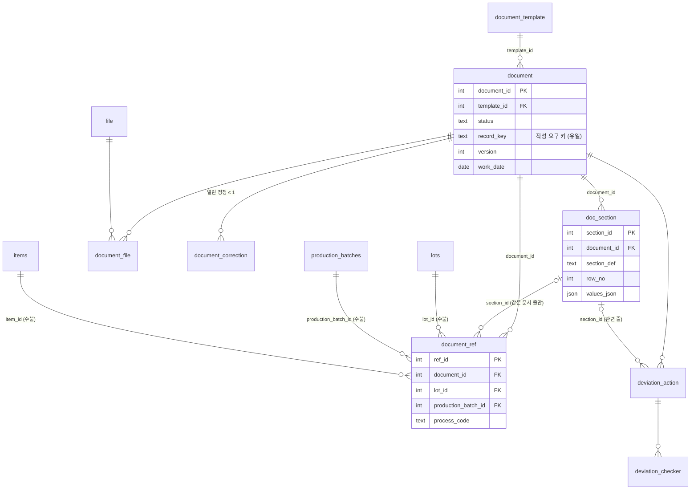
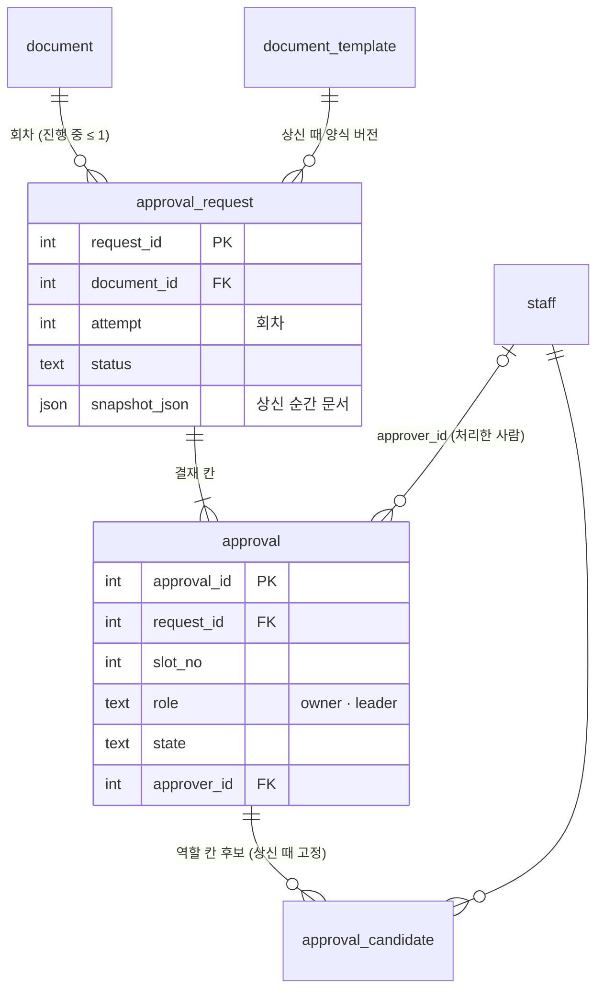
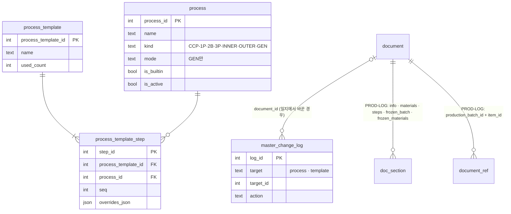

# ERD — 문서 쪽

문서·결재·생산일지 영역의 표 16개입니다. 영역마다 관계 그림을 먼저 두고, 표마다 컬럼·키·제약·앱 규칙을 적습니다. 전체 구조와 읽는 법은 [ERD 안내](README.md)를 먼저 봅니다.

> 현재 기준 2026-10-27 · 기준 코드 `2234f02`(main) · 형·NULL·기본값·키·제약은 빈 DB에 `migrate`한 실제 스키마에서 그대로 옮겼습니다(전체 SQL은 [schema.sql](schema.sql)).

| 영역 | 표 |
|---|---|
| [문서](#문서) | [`document_template`](#document_template) · [`document`](#document) · [`doc_section`](#doc_section) · [`document_ref`](#document_ref) · [`file`](#file) · [`document_file`](#document_file) · [`deviation_action`](#deviation_action) · [`deviation_checker`](#deviation_checker) · [`document_correction`](#document_correction) |
| [결재](#결재) | [`approval_request`](#approval_request) · [`approval`](#approval) · [`approval_candidate`](#approval_candidate) |
| [생산일지·생산 기준정보](#생산일지생산-기준정보) | [`process`](#process) · [`process_template`](#process_template) · [`process_template_step`](#process_template_step) · [`master_change_log`](#master_change_log) |

**읽는 법**

- **NULL 허용** 칸이 비어 있으면 NOT NULL입니다.
- **키**의 FK는 `표.컬럼`이고, 괄호 안은 지울 때 동작입니다(없으면 `NO ACTION` — 참조되는 행은 지울 수 없음).
- **검사**는 DB의 CHECK 제약 그대로입니다. 긴 식은 줄였으니 전체는 [schema.sql](schema.sql)에서 봅니다.
- **앱 규칙**은 DB로 막지 않고 코드가 지키는 규칙입니다. 직접 DB를 고칠 때 특히 주의합니다.

## 문서

사람 컬럼(`created_by`·`completed_by`·`recorded_by`·`checked_by` 등)은 모두 수불 `staff.id`를 가리킵니다. 그림에서는 뺐습니다.

### `document_template` — 양식

양식 하나의 한 버전. 칸 구성은 `schema_json`에 있고, **만든 뒤에는 내용을 바꾸지 않습니다**(바꿀 때는 새 버전 행을 추가).

| 소유 앱 | 만드는 곳 | 쓰는 API |
|---|---|---|
| `documents` | Django 모델 (`backend/apps/documents/models.py`) | `DOC-A02`·`DOC-A03` |

| 컬럼 | 형 | NULL 허용 | 기본값 | 키 | 설명 |
|---|---|---|---|---|---|
| `template_id` | INTEGER |  |  | PK | 양식 버전 번호 |
| `type_code` | TEXT |  |  |  | 양식 코드(D01·CCP-1P·PROD-LOG …) |
| `version` | INTEGER |  |  |  | 양식 버전(1, 2, 3 …) |
| `name` | TEXT |  |  |  | 양식 이름(화면·종이 제목) |
| `schema_json` | TEXT |  |  |  | 양식 정의 → [json.md](json.md#양식-정의-document_templateschema_json) |
| `is_active` | bool |  |  |  | 새 문서에 쓰는 버전이면 1. 한 양식 코드에 보통 1개 |
| `created_at` | datetime |  |  |  | 등록 시각 |

**키·제약**

- 유일: (type_code, version)
- 검사 `(이름 없음)`: `(JSON_VALID(schema_json) OR schema_json IS NULL)`

**앱 규칙**(DB가 아니라 코드가 지킴)

- 새 문서는 그 양식 코드의 사용 중 버전으로 만들고, 이미 만든 문서는 만든 때의 버전을 계속 씁니다.
- 양식 등록·버전 추가는 마이그레이션과 `install_document_templates` 명령이 합니다(화면 없음).

### `document` — 문서

문서 한 건의 머리와 상태. 칸 값은 `doc_section`에, 업무 대상(LOT·배치)은 `document_ref`에 있습니다.

| 소유 앱 | 만드는 곳 | 쓰는 API |
|---|---|---|
| `documents` | Django 모델 (`backend/apps/documents/models.py`) | `DOC-A04`~`DOC-A10` · `DOC-A18`~`DOC-A25` · `WF-A01` |

| 컬럼 | 형 | NULL 허용 | 기본값 | 키 | 설명 |
|---|---|---|---|---|---|
| `document_id` | INTEGER |  |  | PK | 문서 번호(화면의 #번호) |
| `subject` | TEXT | 예 |  |  | 제목·대상 글자 |
| `work_date` | date |  |  |  | 작업일(입고일·제조일·점검일). 목록·묶음의 기준 |
| `due_at` | datetime | 예 |  |  | 기한(지금 화면에서 거의 안 씀) |
| `status` | TEXT |  |  |  | 상태 → [README](README.md#상태-코드-값) |
| `submitted_at` | datetime | 예 |  |  | 처음 상신한 시각(상신 이력 판단 — 삭제 가능 여부) |
| `created_at` | datetime |  |  |  | 만든 시각 |
| `updated_at` | datetime |  |  |  | 마지막 변경 시각 |
| `record_key` | TEXT | 예 |  |  | 작성 요구 키. 자동으로 만든 문서만 있고, 같은 키로 두 번 만들지 않게 함 — 형식 `D03\|lot:12` · `CCP-1P\|batch:5` · `PROD-LOG\|batch:5` · `D10\|day:2026-10-27` · `D11\|week:2026-10-26` |
| `completed_at` | datetime | 예 |  |  | 작성완료 시각 |
| `version` | INTEGER |  | `1` |  | 낙관적 잠금 버전. 바뀔 때마다 +1, 요청의 `expected_version`과 비교 |
| `deleted_at` | datetime | 예 |  |  | 논리 삭제 시각(NULL이면 살아 있음) |
| `assignee_id` | bigint | 예 |  | FK → `staff.id` | **쓰지 않음**. 옛 문서 머리 담당자 칸(P14부터 담당자는 양식에 있음, D-181) |
| `completed_by` | bigint | 예 |  | FK → `staff.id` | 작성완료한 사람 |
| `created_by` | bigint |  |  | FK → `staff.id` | 만든 사람(자동 생성은 입고 등록한 사람 등) |
| `deleted_by` | bigint | 예 |  | FK → `staff.id` | 삭제한 사람 |
| `template_id` | INTEGER |  |  | FK → `document_template.template_id` | 양식 버전 |
| `skip_reason` | TEXT | 예 |  |  | 작성 안 함 사유(1~200자) |
| `skipped_at` | datetime | 예 |  |  | 작성 안 함 시각 |
| `skipped_by` | bigint | 예 |  | FK → `staff.id` | 작성 안 함 처리자 |

**키·제약**

- 인덱스 `ix_document_list`: `document (work_date DESC, document_id DESC) WHERE deleted_at IS NULL`
- 유일 인덱스 `ux_document_record_key`: `document (record_key) WHERE record_key IS NOT NULL`
- 검사 `ck_document_deleted_pair`: `((deleted_at IS NULL AND deleted_by IS NULL) OR (deleted_at IS NOT NULL AND deleted_by IS NOT NULL))`
- 검사 `ck_document_completed_pair`: `((completed_at IS NULL AND completed_by IS NULL) OR (completed_at IS NOT NULL AND completed_by IS NOT NULL))`
- 검사 `ck_document_completed_required`: `(NOT (status = 'completed') OR completed_at IS NOT NULL)`
- 검사 `ck_document_status`: `status IN ('draft', 'completed', 'submitted', 'approved', 'rejected', 'correcting', 'skipped')`
- 검사 `ck_document_draft_not_completed`: `(NOT (status IN ('draft', 'correcting', 'skipped')) OR completed_at IS NULL)`
- 검사 `ck_document_skipped_status`: `((skipped_at IS NOT NULL AND status = 'skipped') OR (NOT (status = 'skipped') AND skipped_at IS NULL))`
- 검사 `ck_document_skipped_pair`: `((skip_reason IS NULL AND skipped_at IS NULL AND skipped_by IS NULL) OR (skip_reason IS NOT NULL AND skipped_at IS NOT NULL AND skipped_by …`
- 검사 `ck_document_skip_reason`: `(skip_reason IS NULL OR (LENGTH(skip_reason) >= 1 AND LENGTH(skip_reason) <= 200 AND NOT (TRIM(skip_reason, ' ' || char(9) || char(10) || c…`

**앱 규칙**(DB가 아니라 코드가 지킴)

- 수정할 수 있는 상태는 `draft`·`rejected`·`correcting`, 지울 수 있는 것은 상신 이력 없는 `draft`이고 작성 요구 문서가 아닌 것(주기 문서는 예외).
- 점검자는 컬럼이 아니라 `doc_section`의 기본정보(`info`) 행 값 `inspector`에 있습니다.
- 목록 조회는 `deleted_at IS NULL` 부분 인덱스(`ix_document_list`)를 탑니다.

### `doc_section` — 문서 칸 값

문서의 영역(섹션) 한 줄. 반복 영역(측정 기록 등)은 줄마다 한 행, 한 번만 있는 영역(기본정보 등)은 한 행입니다.

| 소유 앱 | 만드는 곳 | 쓰는 API |
|---|---|---|
| `documents` | Django 모델 (`backend/apps/documents/models.py`) | `DOC-A05`·`DOC-A07` |

| 컬럼 | 형 | NULL 허용 | 기본값 | 키 | 설명 |
|---|---|---|---|---|---|
| `section_id` | INTEGER |  |  | PK | 줄 번호 |
| `section_def` | TEXT |  |  |  | 영역 키(양식 정의의 `sections[].key` — `info`·`rounds`·`checks` …) |
| `row_no` | INTEGER |  |  |  | 영역 안 줄 순서 |
| `values_json` | TEXT |  |  |  | 칸 값 → [json.md](json.md#칸-값-doc_sectionvalues_json) |
| `recorded_at` | datetime | 예 |  |  | 그 줄을 기록한 시각 |
| `recorded_by` | bigint | 예 |  | FK → `staff.id` | 그 줄을 기록한 사람(CCP 종이의 서명 칸) |
| `document_id` | INTEGER |  |  | FK → `document.document_id` | 문서 |

**키·제약**

- 유일 인덱스 `ux_section_round`: `doc_section ( document_id, section_def, json_extract(values_json, '$.round') ) WHERE json_extract(values_json, '$.round') IS NOT NULL AND COALESCE(json_extract…`
- 유일: (section_id, document_id)
- 유일: (document_id, section_def, row_no)
- 검사 `(이름 없음)`: `(JSON_VALID(values_json) OR values_json IS NULL)`

**앱 규칙**(DB가 아니라 코드가 지킴)

- 계산 칸(CCP 판정·총 건조시간·D03 시험성적서 유무)은 저장할 때 서버가 다시 계산해 덮어씁니다.
- `(section_id, document_id)` 유일 키는 `document_ref`가 "같은 문서의 줄"만 가리키게 하는 복합 FK용입니다.

### `document_ref` — 문서 ↔ 업무 대상

문서가 어느 LOT·생산 배치·품목·공정에 대한 것인지 잇습니다. **수불 표에 DB FK로 직접 걸린 유일한 문서 표**입니다.

| 소유 앱 | 만드는 곳 | 쓰는 API |
|---|---|---|
| `documents` | SQL (`documents/migrations/0002_sql_indexes_document_ref.py`) | `REQ-A01`·`REQ-A02` · 수불 연동 함수 |

| 컬럼 | 형 | NULL 허용 | 기본값 | 키 | 설명 |
|---|---|---|---|---|---|
| `ref_id` | INTEGER | 예 |  | PK | 연결 번호 |
| `document_id` | INTEGER |  |  | FK → `doc_section.document_id (CASCADE)`, `document.document_id (CASCADE)` | 문서 |
| `section_id` | INTEGER | 예 |  | FK → `doc_section.section_id (CASCADE)` | 특정 줄에 대한 연결이면 그 줄(같은 문서의 줄만 — 복합 FK) |
| `lot_id` | INTEGER | 예 |  | FK → `lots.id (RESTRICT)` | 입고 LOT (`lots.id`) |
| `production_batch_id` | INTEGER | 예 |  | FK → `production_batches.id (RESTRICT)` | 제조 배치 (`production_batches.id`) |
| `item_id` | INTEGER | 예 |  | FK → `items.id (RESTRICT)` | 품목 (`items.id`) |
| `process_code` | TEXT | 예 |  |  | 공정 코드(CCP 일지: `1P`·`2B`·`3P`) |
| `label` | TEXT | 예 |  |  | 화면 표시용 대상 글자(100자) |
| `created_at` | TEXT |  |  |  | 연결 시각 |

**키·제약**

- 인덱스 `ix_document_ref_label`: `document_ref (label) WHERE label IS NOT NULL`
- 인덱스 `ix_document_ref_process`: `document_ref (process_code) WHERE process_code IS NOT NULL`
- 인덱스 `ix_document_ref_item`: `document_ref (item_id) WHERE item_id IS NOT NULL`
- 인덱스 `ix_document_ref_batch`: `document_ref (production_batch_id, process_code) WHERE production_batch_id IS NOT NULL`
- 인덱스 `ix_document_ref_lot`: `document_ref (lot_id) WHERE lot_id IS NOT NULL`
- 유일 인덱스 `ux_document_ref`: `document_ref ( document_id, COALESCE(section_id, 0), COALESCE(lot_id, 0), COALESCE(production_batch_id, 0), COALESCE(item_id, 0), COALESCE(process_code, ''))`
- 검사 `(이름 없음)`: `label IS NULL OR length(label) <= 100`
- 검사 `(이름 없음)`: `lot_id IS NOT NULL OR production_batch_id IS NOT NULL OR item_id IS NOT NULL OR process_code IS NOT NULL`

**앱 규칙**(DB가 아니라 코드가 지킴)

- LOT·배치·품목은 `ON DELETE RESTRICT` — 문서가 걸린 LOT·배치는 DB에서 지울 수 없습니다(입고 취소는 문서를 논리 삭제).
- 문서를 지우면(물리 삭제) 연결도 함께 지워집니다(`CASCADE`). 평소에는 문서를 논리 삭제하므로 연결은 남습니다.

### `file` — 첨부 파일

올린 파일 하나. 파일 본체는 데이터 폴더에 있고 이 표는 경로·이름·형식·해시를 가집니다.

| 소유 앱 | 만드는 곳 | 쓰는 API |
|---|---|---|
| `documents` | Django 모델 (`backend/apps/documents/models.py`) | `DOC-A11`~`DOC-A14` |

| 컬럼 | 형 | NULL 허용 | 기본값 | 키 | 설명 |
|---|---|---|---|---|---|
| `file_id` | INTEGER |  |  | PK | 파일 번호 |
| `storage_path` | TEXT |  |  |  | 데이터 폴더 안 저장 경로(유일) |
| `original_name` | TEXT |  |  |  | 올린 파일 이름(1~255자) |
| `mime_type` | TEXT |  |  |  | `application/pdf`·`image/jpeg`·`image/png` |
| `size_bytes` | INTEGER |  |  |  | 크기(1바이트~20MB) |
| `sha256` | TEXT |  |  |  | 내용 해시(64자) |
| `uploaded_at` | datetime |  |  |  | 올린 시각 |
| `retained_at` | datetime | 예 |  |  | 보존 표시 시각 — 상신된 문서에 붙은 적 있으면 연결을 끊어도 지우지 않음 |
| `uploaded_by` | bigint |  |  | FK → `staff.id` | 올린 사람 |

**키·제약**

- 유일: (storage_path)
- 검사 `ck_file_name`: `(LENGTH(original_name) >= 1 AND LENGTH(original_name) <= 255)`
- 검사 `ck_file_mime`: `mime_type IN ('application/pdf', 'image/jpeg', 'image/png')`
- 검사 `ck_file_size`: `(size_bytes >= 1 AND size_bytes <= 20971520)`
- 검사 `ck_file_sha256`: `LENGTH(sha256) = 64`

**앱 규칙**(DB가 아니라 코드가 지킴)

- 확장자만이 아니라 내용으로 형식을 검사합니다.
- 마지막 연결을 끊으면 파일을 지우되, `retained_at`이 있으면 남깁니다.

### `document_file` — 문서 ↔ 첨부 파일

파일을 문서에 연결합니다. 같은 파일을 여러 문서(같은 성적서를 여러 LOT)에 연결할 수 있습니다.

| 소유 앱 | 만드는 곳 | 쓰는 API |
|---|---|---|
| `documents` | Django 모델 (`backend/apps/documents/models.py`) | `DOC-A11`·`DOC-A12` |

| 컬럼 | 형 | NULL 허용 | 기본값 | 키 | 설명 |
|---|---|---|---|---|---|
| `file_id` | INTEGER |  |  | PK FK → `file.file_id` | 파일 |
| `document_id` | INTEGER |  |  | PK FK → `document.document_id` | 문서 |
| `linked_at` | datetime |  |  |  | 연결 시각 |
| `linked_by` | bigint |  |  | FK → `staff.id` | 연결한 사람 |

**키·제약**

- 인덱스 `ix_document_file_file`: `document_file (file_id)`

**앱 규칙**(DB가 아니라 코드가 지킴)

- 같은 양식의 파일만 연결합니다(`FILE_TEMPLATE_MISMATCH`) — 앱에서 검사.

### `deviation_action` — 이탈·개선조치

문서 안의 이탈 한 건과 그 조치. 문서 상태와 상관없이 쓰고 고치며, 문서 버전을 바꾸지 않습니다.

| 소유 앱 | 만드는 곳 | 쓰는 API |
|---|---|---|
| `documents` | Django 모델 (`backend/apps/documents/models.py`) | `DOC-A15`~`DOC-A17` · `DOC-A22`·`DOC-A23` |

| 컬럼 | 형 | NULL 허용 | 기본값 | 키 | 설명 |
|---|---|---|---|---|---|
| `deviation_id` | INTEGER |  |  | PK | 개선조치 번호 |
| `description` | TEXT |  |  |  | 이탈내용(1~500자, 필수) |
| `action_result` | TEXT | 예 |  |  | 개선조치 및 결과(1000자) |
| `checked_at` | datetime | 예 |  |  | 확인 시각 |
| `created_at` | datetime |  |  |  | 만든 시각 |
| `updated_at` | datetime |  |  |  | 마지막 변경 시각 |
| `version` | INTEGER |  | `1` |  | 낙관적 잠금 버전 |
| `deleted_at` | datetime | 예 |  |  | 논리 삭제 |
| `actor_id` | bigint | 예 |  | FK → `staff.id` | 조치자(선택) |
| `checked_by` | bigint | 예 |  | FK → `staff.id` | 확인한 사람 |
| `created_by` | bigint |  |  | FK → `staff.id` | 만든 사람 |
| `deleted_by` | bigint | 예 |  | FK → `staff.id` | 삭제한 사람 |
| `updated_by` | bigint |  |  | FK → `staff.id` | 마지막으로 바꾼 사람 |
| `section_id` | INTEGER | 예 |  | FK → `doc_section.section_id` | 관련 줄(부적합 줄에서 [개선조치 추가]로 들어오면 채워짐) |
| `document_id` | INTEGER |  |  | FK → `document.document_id` | 문서 |

**키·제약**

- 인덱스 `ix_deviation_document`: `deviation_action (document_id) WHERE deleted_at IS NULL`
- 검사 `ck_deviation_description`: `(LENGTH(description) >= 1 AND LENGTH(description) <= 500 AND NOT (TRIM(description, ' ' || char(9) || char(10) || char(13)) = ''))`
- 검사 `ck_deviation_result`: `(action_result IS NULL OR LENGTH(action_result) <= 1000)`
- 검사 `ck_deviation_checked_pair`: `((checked_at IS NULL AND checked_by IS NULL) OR (checked_at IS NOT NULL AND checked_by IS NOT NULL))`
- 검사 `ck_deviation_deleted_pair`: `((deleted_at IS NULL AND deleted_by IS NULL) OR (deleted_at IS NOT NULL AND deleted_by IS NOT NULL))`
- 검사 `ck_deviation_version`: `version >= 1`

**앱 규칙**(DB가 아니라 코드가 지킴)

- 확인(`checked_*`)은 되돌리지 않습니다. 확인 뒤 내용을 고쳐도 확인 기록은 남습니다.
- 상신 순간의 개선조치는 `approval_request.snapshot_json`에 함께 남습니다.

### `deviation_checker` — 개선조치 확인자

개선조치 한 줄을 확인할 수 있는 사람. 저장할 때 **그 양식 담당자 + HACCP팀장**(10명까지, 담당자 먼저)으로 자동으로 채웁니다.

| 소유 앱 | 만드는 곳 | 쓰는 API |
|---|---|---|
| `documents` | Django 모델 (`backend/apps/documents/models.py`) | `DOC-A15`·`DOC-A23` |

| 컬럼 | 형 | NULL 허용 | 기본값 | 키 | 설명 |
|---|---|---|---|---|---|
| `staff_id` | bigint |  |  | PK FK → `staff.id` | 확인자 |
| `deviation_id` | INTEGER |  |  | PK FK → `deviation_action.deviation_id` | 개선조치 |

**키·제약**

- 인덱스 `ix_deviation_checker_staff`: `deviation_checker (staff_id)`

**앱 규칙**(DB가 아니라 코드가 지킴)

- 0명이면 저장은 되고 응답에 `checker_warning`. 그때는 HACCP팀장이 확인합니다.
- HACCP팀장은 이 표에 없어도 모든 개선조치를 확인할 수 있습니다.

### `document_correction` — 정정 기록

승인된 문서를 고치는 정정 한 번. 열린 정정은 문서마다 1개(`ux_correction_open`).

| 소유 앱 | 만드는 곳 | 쓰는 API |
|---|---|---|
| `documents` | Django 모델 (`backend/apps/documents/models.py`) | `DOC-A18`·`DOC-A19` |

| 컬럼 | 형 | NULL 허용 | 기본값 | 키 | 설명 |
|---|---|---|---|---|---|
| `correction_id` | INTEGER |  |  | PK | 정정 번호 |
| `started_at` | datetime |  |  |  | 정정 시작 시각 |
| `reason` | TEXT |  |  |  | 정정 사유(1~200자) |
| `start_version` | INTEGER |  |  |  | 정정 시작 때 문서 버전 — 그 뒤 고쳤는지 판단(정정 취소 가능 여부) |
| `prev_completed_at` | datetime | 예 |  |  | 정정 전 작성완료 시각(되돌릴 때 씀) |
| `closed_at` | datetime | 예 |  |  | 끝난 시각 |
| `outcome` | TEXT | 예 |  |  | `approved`(새 승인) / `cancelled`(정정 취소) |
| `document_id` | INTEGER |  |  | FK → `document.document_id` | 문서 |
| `prev_completed_by` | bigint | 예 |  | FK → `staff.id` | 정정 전 작성완료한 사람 |
| `started_by` | bigint |  |  | FK → `staff.id` | 정정 시작한 사람(담당자·HACCP팀장) |

**키·제약**

- 유일 인덱스 `ux_correction_open`: `document_correction (document_id) WHERE closed_at IS NULL`
- 인덱스 `ix_correction_document`: `document_correction (document_id, started_at)`
- 검사 `ck_correction_reason`: `(LENGTH(reason) >= 1 AND LENGTH(reason) <= 200 AND NOT (TRIM(reason, ' ' || char(9) || char(10) || char(13)) = ''))`
- 검사 `ck_correction_start_version`: `start_version >= 1`
- 검사 `ck_correction_prev_pair`: `((prev_completed_at IS NULL AND prev_completed_by IS NULL) OR (prev_completed_at IS NOT NULL AND prev_completed_by IS NOT NULL))`
- 검사 `ck_correction_closed_pair`: `((closed_at IS NULL AND outcome IS NULL) OR (closed_at IS NOT NULL AND outcome IN ('approved', 'cancelled') AND outcome IS NOT NULL))`

**앱 규칙**(DB가 아니라 코드가 지킴)

- 정정이 열려 있는 동안 출력·유효 승인본은 이전 승인본(이전 결재 회차의 스냅샷)입니다.

---

## 결재

### `approval_request` — 결재 회차

상신 한 번 = 한 행(1회차, 2회차 …). 상신 순간의 문서 전체를 `snapshot_json`으로 저장합니다.

| 소유 앱 | 만드는 곳 | 쓰는 API |
|---|---|---|
| `approvals` | Django 모델 (`backend/apps/approvals/models.py`) | `WF-A01`·`WF-F05` · `APR-A01`~`APR-A03` |

| 컬럼 | 형 | NULL 허용 | 기본값 | 키 | 설명 |
|---|---|---|---|---|---|
| `request_id` | INTEGER |  |  | PK | 결재 요청 번호 |
| `attempt` | INTEGER |  |  |  | 회차(문서마다 1부터) |
| `status` | TEXT |  |  |  | `in_progress`·`approved`·`rejected`·`cancelled` |
| `document_version` | INTEGER |  |  |  | 상신 때 문서 버전 |
| `subject` | TEXT | 예 |  |  | 상신 때 제목(결재함 요약) |
| `work_date` | date |  |  |  | 상신 때 작업일(결재함 요약) |
| `snapshot_json` | TEXT |  |  |  | 상신 순간 문서 전체 → [json.md](json.md#결재-스냅샷-approval_requestsnapshot_json) |
| `requested_at` | datetime |  |  |  | 상신 시각 |
| `closed_at` | datetime | 예 |  |  | 끝난 시각(승인·반려·상신 취소) |
| `document_id` | INTEGER |  |  | FK → `document.document_id` | 문서 |
| `requested_by` | bigint |  |  | FK → `staff.id` | 상신한 사람 |
| `template_id` | INTEGER |  |  | FK → `document_template.template_id` | 상신 때 양식 버전 |

**키·제약**

- 유일 인덱스 `ux_request_open`: `approval_request (document_id) WHERE status = 'in_progress'`
- 유일: (document_id, attempt)
- 검사 `(이름 없음)`: `(JSON_VALID(snapshot_json) OR snapshot_json IS NULL)`
- 검사 `ck_request_attempt`: `attempt >= 1`
- 검사 `ck_request_closed`: `((closed_at IS NULL AND status = 'in_progress') OR (NOT (status = 'in_progress') AND closed_at IS NOT NULL))`
- 검사 `ck_request_status`: `status IN ('in_progress', 'approved', 'rejected', 'cancelled')`

**앱 규칙**(DB가 아니라 코드가 지킴)

- 진행 중 회차는 문서마다 1개(`ux_request_open`).
- 결재자가 보는 내용과 출력의 결재본은 이 스냅샷입니다(문서 현재 값이 아님).

### `approval` — 결재 칸

회차 안의 결재 칸 하나(담당자 칸·팀장 칸). 칸마다 1명이 처리하면 되고 칸 사이 순서는 없습니다.

| 소유 앱 | 만드는 곳 | 쓰는 API |
|---|---|---|
| `approvals` | Django 모델 (`backend/apps/approvals/models.py`) | `WF-A02`·`WF-A03` · `APR-A01` |

| 컬럼 | 형 | NULL 허용 | 기본값 | 키 | 설명 |
|---|---|---|---|---|---|
| `approval_id` | INTEGER |  |  | PK | 결재 칸 번호 |
| `slot_no` | INTEGER |  |  |  | 칸 순서(1부터) |
| `label` | TEXT | 예 |  |  | 칸 표시 이름(예: D10 "작성자") |
| `state` | TEXT |  | `'pending'` |  | `pending`·`approved`·`rejected`·`skipped`(회차가 끝나 처리하지 않고 닫힘) |
| `comment` | TEXT | 예 |  |  | 의견(반려면 필수) |
| `decided_at` | datetime | 예 |  |  | 처리 시각 |
| `approver_id` | bigint | 예 |  | FK → `staff.id` | 처리한 사람. 역할 칸은 처리 전 NULL |
| `request_id` | INTEGER |  |  | FK → `approval_request.request_id` | 회차 |
| `role` | TEXT | 예 |  |  | `owner`(담당자 칸) / `leader`(팀장 칸). NULL은 P14 전 옛 방식(결재자를 지정) |

**키·제약**

- 인덱스 `ix_approval_inbox`: `approval (approver_id, state)`
- 유일: (request_id, slot_no)
- 검사 `ck_approval_slot_no`: `slot_no >= 1`
- 검사 `ck_approval_state`: `state IN ('pending', 'approved', 'rejected', 'skipped')`
- 검사 `ck_approval_decided`: `((decided_at IS NULL AND state = 'pending') OR (NOT (state = 'pending') AND decided_at IS NOT NULL))`
- 검사 `ck_approval_reject_comment`: `(NOT (state = 'rejected') OR (comment IS NOT NULL AND NOT (TRIM(comment) = '' AND comment IS NOT NULL)))`
- 검사 `ck_approval_role`: `(role IS NULL OR role IN ('owner', 'leader'))`
- 검사 `ck_approval_approver`: `((approver_id IS NOT NULL AND role IS NULL) OR (approver_id IS NOT NULL AND role IS NOT NULL AND state IN ('approved', 'rejected')) OR (app…`

**앱 규칙**(DB가 아니라 코드가 지킴)

- 역할 칸의 후보는 `approval_candidate`에 상신 순간 고정됩니다. 그 뒤 역할 설정이 바뀌어도 이번 회차 후보는 그대로입니다.
- 한 칸이라도 반려하면 회차 `rejected`, 모든 칸 승인이면 `approved`.

### `approval_candidate` — 결재 칸 후보

역할 칸을 처리할 수 있는 사람들. 상신 순간 그 역할을 가진 사람 전부를 넣습니다.

| 소유 앱 | 만드는 곳 | 쓰는 API |
|---|---|---|
| `approvals` | Django 모델 (`backend/apps/approvals/models.py`) | `WF-A01` · `APR-A01` |

| 컬럼 | 형 | NULL 허용 | 기본값 | 키 | 설명 |
|---|---|---|---|---|---|
| `staff_id` | bigint |  |  | PK FK → `staff.id` | 후보 |
| `approval_id` | INTEGER |  |  | PK FK → `approval.approval_id` | 결재 칸 |

**키·제약**

- 인덱스 `ix_approval_candidate_staff`: `approval_candidate (staff_id)`

**앱 규칙**(DB가 아니라 코드가 지킴)

- 결재함(`APR-A01`)은 이 표로 "내가 처리할 칸"을 찾습니다.

---

## 생산일지·생산 기준정보

생산일지 문서 자체는 문서 표(`document`·`doc_section`·`document_ref`)를 그대로 씁니다. 생산일지 전용 표는 공정·템플릿·이력 4개뿐입니다. 공정 줄(`steps`)은 `process_id`를 값으로 가지지만 DB FK는 아닙니다(JSON 안).

### `process` — 공정

생산일지에 넣는 공정 목록(생산 기준정보). 기본 제공 5종 + 사용자가 추가한 일반 공정.

| 소유 앱 | 만드는 곳 | 쓰는 API |
|---|---|---|
| `production_log` | Django 모델 (`backend/apps/production_log/models.py`) | `PLG-A06` · `PLG-A05` |

| 컬럼 | 형 | NULL 허용 | 기본값 | 키 | 설명 |
|---|---|---|---|---|---|
| `process_id` | INTEGER |  |  | PK | 공정 번호 |
| `name` | TEXT |  |  |  | 이름(1~40자) |
| `name_key` | TEXT |  |  |  | 중복 판정용 이름(공백 정리·대소문자 무시). 사용 중끼리 유일 |
| `kind` | TEXT |  |  |  | `CCP-1P`·`CCP-2B`·`CCP-3P`·`INNER`(내포장)·`OUTER`(외포장)·`GEN`(일반) |
| `mode` | TEXT | 예 |  |  | 일반 공정만: `JUDGE`(판정)·`TEMP_TIME`(온도·시간)·`QTY`(수량) |
| `is_builtin` | bool |  |  |  | 기본 제공이면 1(`kind`≠GEN) |
| `description` | TEXT | 예 |  |  | 설명(300자) |
| `std_duration_value` | REAL | 예 |  |  | 표준 소요기간 값 |
| `std_duration_unit` | TEXT | 예 |  |  | `분`·`시간`·`일` |
| `is_active` | bool |  |  |  | 사용 중이면 1(기본 제공은 항상 1) |
| `created_at` | datetime |  |  |  | 만든 시각 |
| `updated_at` | datetime |  |  |  | 마지막 변경 시각 |
| `version` | INTEGER |  | `1` |  | 낙관적 잠금 버전 |
| `created_by` | bigint | 예 |  | FK → `staff.id` | 만든 사람(NULL = 시스템 — 기본 제공) |
| `updated_by` | bigint | 예 |  | FK → `staff.id` | 마지막으로 바꾼 사람 |

**키·제약**

- 유일 인덱스 `ux_process_name`: `process (name_key) WHERE is_active`
- 유일 인덱스 `ux_process_builtin`: `process (kind) WHERE NOT (kind = 'GEN')`
- 검사 `ck_process_name`: `(LENGTH(name) >= 1 AND LENGTH(name) <= 40 AND NOT (TRIM(name, ' ' || char(9) || char(10) || char(13)) = ''))`
- 검사 `ck_process_name_key`: `LENGTH(name_key) >= 1`
- 검사 `ck_process_kind`: `kind IN ('CCP-1P', 'CCP-2B', 'CCP-3P', 'INNER', 'OUTER', 'GEN')`
- 검사 `ck_process_mode`: `(mode IS NULL OR mode IN ('JUDGE', 'TEMP_TIME', 'QTY'))`
- 검사 `ck_process_kind_mode`: `((kind = 'GEN' AND mode IS NOT NULL) OR (NOT (kind = 'GEN') AND mode IS NULL))`
- 검사 `ck_process_builtin`: `((kind = 'GEN' AND NOT is_builtin) OR (NOT (kind = 'GEN') AND is_builtin))`
- 검사 `ck_process_builtin_active`: `(NOT is_builtin OR is_active)`
- 검사 `ck_process_description`: `(description IS NULL OR LENGTH(description) <= 300)`
- 검사 `ck_process_std_duration`: `((std_duration_value IS NULL AND std_duration_unit IS NULL) OR (std_duration_value > 0.0 AND std_duration_value IS NOT NULL AND std_duratio…`
- 검사 `ck_process_version`: `version >= 1`

**앱 규칙**(DB가 아니라 코드가 지킴)

- 기본 제공 공정은 `kind`마다 1개(`ux_process_builtin`)이고 표시명·설명·소요기간만 바꿉니다.
- 한 번이라도 쓰인 공정은 지울 수 없고 사용 중지합니다(`PLG_IN_USE`).

### `process_template` — 공정 템플릿

공정 순서 묶음. 생산일지에서 불러와 공정을 한 번에 넣습니다.

| 소유 앱 | 만드는 곳 | 쓰는 API |
|---|---|---|
| `production_log` | Django 모델 (`backend/apps/production_log/models.py`) | `PLG-A07` · `PLG-A02`·`PLG-A03` |

| 컬럼 | 형 | NULL 허용 | 기본값 | 키 | 설명 |
|---|---|---|---|---|---|
| `process_template_id` | INTEGER |  |  | PK | 템플릿 번호 |
| `name` | TEXT |  |  |  | 이름(1~40자) |
| `name_key` | TEXT |  |  |  | 중복 판정용 이름(공백 정리·대소문자 무시). 사용 중끼리 유일 |
| `is_active` | bool |  |  |  | 사용 중이면 1 |
| `used_count` | INTEGER |  | `0` |  | 불러온 횟수 |
| `last_used_at` | datetime | 예 |  |  | 마지막으로 불러온 시각 |
| `created_at` | datetime |  |  |  | 만든 시각 |
| `updated_at` | datetime |  |  |  | 마지막 변경 시각 |
| `version` | INTEGER |  | `1` |  | 낙관적 잠금 버전 |
| `created_by` | bigint |  |  | FK → `staff.id` | 만든 사람 |
| `updated_by` | bigint |  |  | FK → `staff.id` | 마지막으로 바꾼 사람 |

**키·제약**

- 유일 인덱스 `ux_process_template_name`: `process_template (name_key) WHERE is_active`
- 검사 `ck_process_template_name`: `(LENGTH(name) >= 1 AND LENGTH(name) <= 40 AND NOT (TRIM(name, ' ' || char(9) || char(10) || char(13)) = ''))`
- 검사 `ck_process_template_name_key`: `LENGTH(name_key) >= 1`
- 검사 `ck_process_template_used`: `used_count >= 0`
- 검사 `ck_process_template_last_used`: `(used_count = 0 OR last_used_at IS NOT NULL)`
- 검사 `ck_process_template_version`: `version >= 1`

**앱 규칙**(DB가 아니라 코드가 지킴)

- 한 번도 불러오지 않은 템플릿만 지울 수 있습니다.

### `process_template_step` — 템플릿 단계

템플릿 안의 공정 하나와 그 순서.

| 소유 앱 | 만드는 곳 | 쓰는 API |
|---|---|---|
| `production_log` | Django 모델 (`backend/apps/production_log/models.py`) | `PLG-A07` |

| 컬럼 | 형 | NULL 허용 | 기본값 | 키 | 설명 |
|---|---|---|---|---|---|
| `step_id` | INTEGER |  |  | PK | 단계 번호 |
| `seq` | INTEGER |  |  |  | 순서(1부터) |
| `overrides_json` | TEXT |  |  |  | 이 단계에서 덮어쓸 값 → [json.md](json.md#템플릿-덮어쓸-값-process_template_stepoverrides_json) |
| `process_id` | INTEGER |  |  | FK → `process.process_id` | 공정 |
| `process_template_id` | INTEGER |  |  | FK → `process_template.process_template_id` | 템플릿 |

**키·제약**

- 인덱스 `ix_template_step_process`: `process_template_step (process_id)`
- 유일: (process_template_id, process_id)
- 유일: (process_template_id, seq)
- 검사 `(이름 없음)`: `(JSON_VALID(overrides_json) OR overrides_json IS NULL)`
- 검사 `ck_template_step_seq`: `seq >= 1`

**앱 규칙**(DB가 아니라 코드가 지킴)

- 한 템플릿에 같은 공정은 한 번만, 최대 30단계.

### `master_change_log` — 생산 기준정보 변경 이력

공정·템플릿의 모든 변경. 화면 **[이력]**.

| 소유 앱 | 만드는 곳 | 쓰는 API |
|---|---|---|
| `production_log` | Django 모델 (`backend/apps/production_log/models.py`) | `PLG-A08` |

| 컬럼 | 형 | NULL 허용 | 기본값 | 키 | 설명 |
|---|---|---|---|---|---|
| `log_id` | INTEGER |  |  | PK | 이력 번호 |
| `target` | TEXT |  |  |  | `process` / `template` |
| `target_id` | INTEGER |  |  |  | 대상 번호 |
| `action` | TEXT |  |  |  | `create`·`update`·`deactivate`·`reactivate`·`delete`·`copy`·`register`(일지에서 등록)·`overwrite`(일지에서 덮어쓰기) |
| `before_json` | TEXT | 예 |  |  | 바뀌기 전 값 |
| `after_json` | TEXT | 예 |  |  | 바뀐 뒤 값 |
| `at` | datetime |  |  |  | 시각 |
| `actor_id` | bigint |  |  | FK → `staff.id` | 바꾼 사람 |
| `document_id` | INTEGER | 예 |  | FK → `document.document_id` | 생산일지에서 바꾼 경우 그 문서 |

**키·제약**

- 인덱스 `ix_master_log_target`: `master_change_log (target, target_id, at DESC)`
- 검사 `(이름 없음)`: `(JSON_VALID(before_json) OR before_json IS NULL)`
- 검사 `(이름 없음)`: `(JSON_VALID(after_json) OR after_json IS NULL)`
- 검사 `ck_master_log_target`: `target IN ('process', 'template')`
- 검사 `ck_master_log_action`: `action IN ('create', 'update', 'deactivate', 'reactivate', 'delete', 'copy', 'register', 'overwrite')`
- 검사 `ck_master_log_target_id`: `target_id >= 1`

**앱 규칙**(DB가 아니라 코드가 지킴)

- 대상이 삭제돼도 이력은 남습니다(대상 FK 없음).
