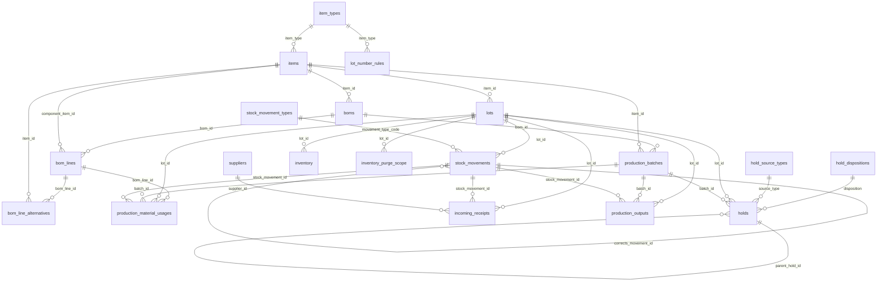

# ERD — 수불 쪽

입고·재고·생산(수불) 영역의 표 22개입니다. 관계 그림을 먼저 두고, 표마다 컬럼·키·제약·트리거·앱 규칙을 적습니다.

> 현재 기준 2026-10-27 · 기준 코드 `2234f02`(main) · 형·NULL·기본값·키·제약·트리거는 빈 DB에 `migrate`한 실제 스키마에서 옮겼습니다.
>
> **[수불 담당 확인 전 초안]** 컬럼 설명·앱 규칙은 SQL 파일 머리말(`backend/apps/inventory/sql/0001`~`0009`), 코드, [수불 결정](../../reference/inventory-decisions.md)을 근거로 문서 담당이 썼습니다. 수불 담당이 확인하기 전까지는 참고로만 봅니다.

## 문서 쪽과 다른 점

| 항목 | 수불 쪽 | 문서 쪽 |
|---|---|---|
| 만드는 곳 | SQL 파일 `backend/apps/inventory/sql/*.sql`. 모델은 `managed=False`, 마이그레이션이 SQL을 문장 단위로 실행 | Django 모델 |
| 표 형식 | 모두 `STRICT`(형이 다르면 넣을 때 오류) | 일반 |
| PK | `id` (`item_types`·`stock_movement_types` 등 코드 표는 `code`) | `<표>_id` |
| 수량 | 정수 `*_e6` = 기준단위 × 1,000,000 (50kg → 50000000, 0.25kg → 250000) | — |
| 날짜·시각 | 글자 `YYYY-MM-DD` · `YYYY-MM-DD HH:MM:SS`, **KST, 시간대 표기 없음**. CHECK로 형식 강제 | `datetime` UTC 저장 |
| 규칙 | **트리거 40개**가 DB에서 직접 막음 | 트리거 없음 |
| 고치기 | 기록은 대부분 **추가만**(수불·투입·산출·보류). 잘못되면 정정 기록을 더함 | 상태·버전으로 수정 |

**DB가 지키는 불변식**(0001 머리말): 수량은 양수이고 방향은 수불 유형이 가짐 · 수불 기록은 추가만 · 현재고(`inventory`) = 수불 합계(트리거가 맞춤, 음수면 실패) · LOT이 있는 품목의 구분 변경 금지. 미해제 보류 LOT 사용 금지는 뷰(`v_lot_availability`)로 앱이 확인합니다.

## 관계 그림

FK 37개 중 사람(`staff`)으로 가는 7개를 뺀 30개입니다(컬럼은 그림에서 뺌). 품목(`items`)·LOT(`lots`)·수불(`stock_movements`)·제조 배치(`production_batches`)가 가운데에 있습니다.

`staff`(사람)로 가는 FK 7개는 그림을 읽기 쉽게 하려고 뺐습니다: `audit_logs.staff_id` · `boms.created_by` · `holds.held_by` · `holds.released_by` · `incoming_receipts.staff_id` · `production_batches.staff_id` · `stock_movements.staff_id`.

## 표 목록

| 묶음 | 표 |
|---|---|
| [기준정보](#기준정보) | [`item_types`](#item_types) · [`staff`](#staff) · [`suppliers`](#suppliers) · [`items`](#items) |
| [LOT·재고](#lot재고) | [`lot_number_rules`](#lot_number_rules) · [`lot_number_sequences`](#lot_number_sequences) · [`lots`](#lots) · [`inventory`](#inventory) |
| [수불](#수불) | [`stock_movement_types`](#stock_movement_types) · [`stock_movements`](#stock_movements) · [`incoming_receipts`](#incoming_receipts) · [`audit_logs`](#audit_logs) · [`inventory_purge_scope`](#inventory_purge_scope) |
| [보류](#보류) | [`holds`](#holds) · [`hold_source_types`](#hold_source_types) · [`hold_dispositions`](#hold_dispositions) |
| [BOM](#bom) | [`boms`](#boms) · [`bom_lines`](#bom_lines) · [`bom_line_alternatives`](#bom_line_alternatives) |
| [생산](#생산) | [`production_batches`](#production_batches) · [`production_material_usages`](#production_material_usages) · [`production_outputs`](#production_outputs) |

## 기준정보

### `item_types` — 품목 구분 코드

품목 구분 4가지: `RAW` 원료 · `PACKAGING` 포장재 · `SEMI` 반제품 · `FINISHED` 완제품(0001에서 넣음).

| 컬럼 | 형 | NULL 허용 | 기본값 | 키 | 설명 |
|---|---|---|---|---|---|
| `code` | TEXT |  |  | PK 유일 | 구분 코드 |
| `name` | TEXT |  |  |  | 이름 |
| `code_prefix` | TEXT | 예 |  |  | 품목코드 앞자리(1·2·3·4) |
| `sort_order` | INTEGER |  | `0` |  | 화면 순서 |

**앱 규칙**(코드가 지킴)

- 코드 값은 마이그레이션이 넣고 화면에서 바꾸지 않습니다.

### `staff` — 직원

사람. 수불·문서 양쪽의 모든 사람 컬럼이 이 표의 `id`를 가리킵니다. 로그인 계정은 아닙니다.

| 컬럼 | 형 | NULL 허용 | 기본값 | 키 | 설명 |
|---|---|---|---|---|---|
| `id` | INTEGER | 예 |  | PK | 직원 번호(API의 `X-Staff-Id`) |
| `staff_code` | TEXT |  |  | 유일 | 직원 코드(역할 설정 파일이 이 코드로 사람을 가리킴) |
| `name` | TEXT |  |  |  | 이름(서명·출력에 찍힘) |
| `is_active` | INTEGER |  | `1` |  | 재직(사용) 중이면 1. 0이면 현재 사용자로 고를 수 없음 |
| `created_at` | TEXT |  | `datetime('now', 'localtime')` |  | 만든 시각(KST 글자) |

**앱 규칙**(코드가 지킴)

- 비활성 직원은 쓰기 요청이 거부됩니다(403 `INVALID_STAFF`). 지우지 않고 비활성으로 바꿉니다.

### `suppliers` — 공급처(매입처)

원료·포장재를 사는 곳.

| 컬럼 | 형 | NULL 허용 | 기본값 | 키 | 설명 |
|---|---|---|---|---|---|
| `id` | INTEGER | 예 |  | PK | 공급처 번호 |
| `supplier_code` | TEXT |  |  | 유일 | 공급처 코드 |
| `name` | TEXT |  |  |  | 이름(D01~D03 매입처로 표시) |
| `is_active` | INTEGER |  | `1` |  | 사용 중이면 1 |
| `created_at` | TEXT |  | `datetime('now', 'localtime')` |  | 만든 시각(KST 글자) |

### `items` — 품목

원료·포장재·반제품·완제품. LOT이 생긴 뒤에는 구분과 재고 관리 여부를 바꿀 수 없습니다(트리거).

| 컬럼 | 형 | NULL 허용 | 기본값 | 키 | 설명 |
|---|---|---|---|---|---|
| `id` | INTEGER | 예 |  | PK | 품목 번호 |
| `item_type` | TEXT |  |  | FK → `item_types.code` | 품목 구분 |
| `item_code` | TEXT |  |  | 유일 | 품목 코드(1·2·3·4로 시작) |
| `short_code` | TEXT | 예 |  | 유일 | LOT 약어(A** 원료, B** 반제품, C** 포장재) — LOT 번호 앞자리 |
| `name` | TEXT |  |  |  | 품명 |
| `base_unit` | TEXT |  |  |  | 기준단위(kg·g·개·장 …). 모든 수량은 이 단위의 `*_e6` |
| `unit_weight_mg` | INTEGER | 예 |  |  | 1 기준단위의 표준 중량(mg). 개 단위 품목의 kg 환산용(환 4g = 4000) |
| `shelf_life_days` | INTEGER | 예 |  |  | 소비기한(일) |
| `shelf_life_months` | INTEGER | 예 |  |  | 소비기한(개월). 일수와 둘 중 하나만 |
| `origin_country` | TEXT | 예 |  |  | 원산지 |
| `food_type` | TEXT | 예 |  |  | 식품유형(생산일지 [유형]) |
| `minimum_stock_e6` | INTEGER |  | `0` |  | 최소 재고(e6) |
| `is_active` | INTEGER |  | `1` |  | 사용 중이면 1 |
| `created_at` | TEXT |  | `datetime('now', 'localtime')` |  | 만든 시각(KST 글자) |
| `is_stock_managed` | INTEGER |  | `1` |  | 재고 관리 품목이면 1. 0(정제수 등)이면 LOT·수불이 없고 사용량은 생산일지에 직접 적음 |
| `manufacturing_report_number` | TEXT | 예 |  |  | 품목제조보고번호(생산일지 기본정보) |

**키·제약**

- 검사: `unit_weight_mg IS NULL OR unit_weight_mg > 0`
- 검사: `shelf_life_days IS NULL OR shelf_life_days > 0`
- 검사: `shelf_life_months IS NULL OR shelf_life_months > 0`
- 검사: `minimum_stock_e6 >= 0`
- 검사: `shelf_life_days IS NULL OR shelf_life_months IS NULL`

**트리거**(DB가 직접 막음)

| 트리거 | 때 | 하는 일 |
|---|---|---|
| `trg_items_stock_managed_locked` | BEFORE UPDATE OF is_stock_managed | LOT이 있는 품목은 재고 비관리로 바꿀 수 없음 |
| `trg_items_type_locked` | BEFORE UPDATE OF item_type | LOT이 있는 품목의 구분은 바꿀 수 없음 → 새 품목 |

**앱 규칙**(코드가 지킴)

- 재고 비관리 품목은 BOM에는 남고 투입 기록은 없습니다(생산일지가 사용량을 직접 받음).

---

## LOT·재고

### `lot_number_rules` — LOT 번호 규칙

LOT 번호를 만드는 형식. 입고 LOT·생산 LOT, 품목 구분별로 적용 시작일과 함께 둡니다.

| 컬럼 | 형 | NULL 허용 | 기본값 | 키 | 설명 |
|---|---|---|---|---|---|
| `id` | INTEGER | 예 |  | PK | 규칙 번호 |
| `lot_kind` | TEXT |  |  |  | `INCOMING` 입고 / `PRODUCED` 생산 |
| `item_type` | TEXT | 예 |  | FK → `item_types.code` | 적용 품목 구분(NULL이면 전체) |
| `pattern` | TEXT |  |  |  | 형식, 예 `{short_code}{date:yyMMdd}{seq:-N}` |
| `effective_from` | TEXT |  |  |  | 적용 시작일 |
| `is_active` | INTEGER |  | `1` |  | 사용 중이면 1 |
| `notes` | TEXT | 예 |  |  | 메모 |

**키·제약**

- 검사: `lot_kind IN ('INCOMING', 'PRODUCED')`
- 검사: `effective_from IS date(effective_from)`

**앱 규칙**(코드가 지킴)

- 원료 입고 LOT = 약어 + 소비기한(없으면 입고일), 생산 LOT = 약어 + 제조 시작일. 같은 기준일이 또 나오면 `-2`, `-3`(0005·0007).

### `lot_number_sequences` — LOT 일련번호

같은 기준(품목·날짜)에서 몇 번째 LOT인지 세는 카운터.

| 컬럼 | 형 | NULL 허용 | 기본값 | 키 | 설명 |
|---|---|---|---|---|---|
| `seq_key` | TEXT |  |  | PK 유일 | 기준 키, 예 `1000019-261008` |
| `current_seq` | INTEGER |  | `0` |  | 마지막으로 쓴 번호 |
| `updated_at` | TEXT |  | `datetime('now', 'localtime')` |  | 마지막 변경 시각(KST 글자, 트리거가 갱신) |

**앱 규칙**(코드가 지킴)

- 쓰기 트랜잭션을 `BEGIN IMMEDIATE`로 열어 동시에 같은 번호를 받지 않게 합니다.

### `lots` — LOT

입고 LOT과 생산(산출) LOT. 상태는 **품질 판정만** 나타냅니다 — 재고가 남았는지는 `inventory`, 어떻게 비었는지는 `stock_movements`가 나타냅니다.

| 컬럼 | 형 | NULL 허용 | 기본값 | 키 | 설명 |
|---|---|---|---|---|---|
| `id` | INTEGER | 예 |  | PK | LOT 번호(내부) |
| `lot_number` | TEXT |  |  |  | LOT 번호(화면). 품목 안에서만 유일 |
| `item_id` | INTEGER |  |  | FK → `items.id` | 품목 |
| `lot_kind` | TEXT |  |  |  | `INCOMING` 입고 / `PRODUCED` 생산 |
| `status` | TEXT |  |  |  | `QUARANTINE` 판정 대기 · `AVAILABLE` 적합 · `REJECTED` 부적합 |
| `manufactured_date` | TEXT | 예 |  |  | 제조일 |
| `expiration_date` | TEXT | 예 |  |  | 소비기한 |
| `created_at` | TEXT |  | `datetime('now', 'localtime')` |  | 만든 시각(KST 글자) |
| `updated_at` | TEXT |  | `datetime('now', 'localtime')` |  | 마지막 변경 시각(KST 글자, 트리거가 갱신) |
| `expiration_status` | TEXT |  | `'UNKNOWN'` |  | `KNOWN` 있음(날짜 필수) · `NONE` 없음으로 확인 · `UNKNOWN` 미확인(이관 LOT 등) |

**키·제약**

- 유일: (item_id, lot_number)
- 검사: `lot_kind IN ('INCOMING', 'PRODUCED')`
- 검사: `status IN ('QUARANTINE', 'AVAILABLE', 'REJECTED')`
- 검사: `manufactured_date IS NULL OR manufactured_date IS date(manufactured_date)`
- 검사: `expiration_date IS NULL OR expiration_date IS date(expiration_date)`
- 검사: `expiration_status IN ('KNOWN', 'NONE', 'UNKNOWN')`

**트리거**(DB가 직접 막음)

| 트리거 | 때 | 하는 일 |
|---|---|---|
| `trg_lots_expiration_status_insert` | BEFORE INSERT | KNOWN이면 소비기한 날짜 필수, KNOWN만 날짜를 가짐 |
| `trg_lots_expiration_status_update` | BEFORE UPDATE OF expiration_status, expiration_date | 같음(수정 때) |
| `trg_lots_stock_managed` | BEFORE INSERT | 재고 비관리 품목에는 LOT을 만들 수 없음 |
| `trg_lots_updated_at` | AFTER UPDATE | 수정 때 `updated_at` 자동 갱신 |

**앱 규칙**(코드가 지킴)

- 입고 판정이 정해지면 `AVAILABLE`/`REJECTED`, 미정이면 `QUARANTINE`. 육안검사일지(D03) 작성완료 때 문서 쪽이 판정을 넘깁니다(결재 승인·반려와는 무관).
- 미해제 보류가 있는 LOT은 사용할 수 없습니다 — `v_lot_availability`로 앱이 확인(DB가 막지는 않음).

### `inventory` — LOT별 현재고

LOT마다 지금 남은 양. **수불 기록 합계를 트리거가 자동으로 맞춥니다** — 앱이 직접 쓰지 않습니다.

| 컬럼 | 형 | NULL 허용 | 기본값 | 키 | 설명 |
|---|---|---|---|---|---|
| `lot_id` | INTEGER |  |  | PK FK → `lots.id` | LOT |
| `quantity_e6` | INTEGER |  | `0` |  | 현재고(e6). 0 이상 — 음수가 되면 수불 기록 자체가 실패 |
| `updated_at` | TEXT |  | `datetime('now', 'localtime')` |  | 마지막 변경 시각(KST 글자, 트리거가 갱신) |

**키·제약**

- 검사: `quantity_e6 >= 0`

**앱 규칙**(코드가 지킴)

- 값이 수불 합계와 다르면 `v_inventory_mismatch`에 나옵니다(`check_inventory` 명령).

---

## 수불

### `stock_movement_types` — 수불 유형 코드

수불 기록의 종류와 방향(+1 들어옴 / -1 나감). 0001에서 12가지를 넣음: 입고 · 생산 투입 · 생산 산출 · 출하 · 고객 반품 입고 · 공급처 반품 · 폐기 · 재고조정(증가·감소) · 기초재고 이관 · 정정(증가·감소).

| 컬럼 | 형 | NULL 허용 | 기본값 | 키 | 설명 |
|---|---|---|---|---|---|
| `code` | TEXT |  |  | PK 유일 | 유형 코드(`RECEIPT`·`PRODUCTION_USE`·`PRODUCTION_OUTPUT`·`SHIPMENT`·`CUSTOMER_RETURN`·`RETURN_TO_SUPPLIER`·`DISPOSAL`·`ADJUST_IN`·`ADJUST_OUT`·`OPENING_BALANCE`·`CORRECTION_IN`·`CORRECTION_OUT`) |
| `name` | TEXT |  |  |  | 이름(원료수불대장 표시) |
| `direction` | INTEGER |  |  |  | `1` 증가 / `-1` 감소 |

**키·제약**

- 검사: `direction IN (1, -1)`

**앱 규칙**(코드가 지킴)

- 출하·고객 반품은 코드만 있고 화면은 이번 범위 밖입니다.

### `stock_movements` — 수불 기록

재고가 움직인 모든 기록. **추가만 하고 고치거나 지우지 않습니다** — 잘못된 기록은 정정 기록(`CORRECTION_IN`/`OUT`)을 더합니다.

| 컬럼 | 형 | NULL 허용 | 기본값 | 키 | 설명 |
|---|---|---|---|---|---|
| `id` | INTEGER | 예 |  | PK | 수불 번호 |
| `lot_id` | INTEGER |  |  | FK → `lots.id` | LOT |
| `movement_type_code` | TEXT |  |  | FK → `stock_movement_types.code` | 수불 유형 |
| `quantity_e6` | INTEGER |  |  |  | 수량(e6, 항상 양수 — 방향은 유형이 가짐) |
| `corrects_movement_id` | INTEGER | 예 |  | FK → `stock_movements.id` | 정정이면 정정하는 원 기록(같은 LOT만) |
| `staff_id` | INTEGER |  |  | FK → `staff.id` | 기록한 사람 |
| `occurred_at` | TEXT |  |  |  | 실제 발생 시각(지난 날짜로 넣을 수 있음) |
| `reason` | TEXT | 예 |  |  | 사유. 정정·재고조정이면 필수 |
| `idempotency_key` | TEXT |  |  | 유일 | 같은 요청을 두 번 처리하지 않게 하는 키(유일) |
| `created_at` | TEXT |  | `datetime('now', 'localtime')` |  | 시스템 기록 시각 |
| `ea_count` | INTEGER | 예 |  |  | 참고 개수(선택). 무게와 환산하지 않음 |

**키·제약**

- 검사: `quantity_e6 > 0`
- 검사: `occurred_at IS datetime(occurred_at)`
- 검사: `ea_count IS NULL OR ea_count >= 0`
- 검사: `(movement_type_code IN ('CORRECTION_IN', 'CORRECTION_OUT')) = (corrects_movement_id IS NOT NULL)`
- 검사: `movement_type_code NOT IN ('CORRECTION_IN', 'CORRECTION_OUT', 'ADJUST_IN', 'ADJUST_OUT') OR reason IS NOT NULL`

**트리거**(DB가 직접 막음)

| 트리거 | 때 | 하는 일 |
|---|---|---|
| `trg_sm_correction_lot` | BEFORE INSERT | 정정은 같은 LOT의 원 기록만 가리킴 |
| `trg_sm_inventory` | AFTER INSERT | 수불 기록이 들어오면 `inventory` 현재고를 더하거나 뺌(음수면 실패) |
| `trg_sm_no_delete` | BEFORE DELETE | 수불 기록은 지우지 않음 — 미사용 품목 정리 범위의 입고·정정 기록만 예외 |
| `trg_sm_no_update` | BEFORE UPDATE | 수불 기록은 고치지 않음(정정 기록을 더함) |

**앱 규칙**(코드가 지킴)

- 실제 수량 = 원 수량 − 정정 합계(뷰가 계산, `net_quantity_e6`).
- 예외: 쓰지 않은 품목 정리(`inventory_purge_scope`에 든 LOT의 입고·정정 기록)만 지울 수 있습니다.

### `incoming_receipts` — 입고

입고 한 건. **입고 1건 = LOT 1개 = 입고 수불 기록 1개**입니다.

| 컬럼 | 형 | NULL 허용 | 기본값 | 키 | 설명 |
|---|---|---|---|---|---|
| `id` | INTEGER | 예 |  | PK | 입고 번호 |
| `lot_id` | INTEGER |  |  | 유일 FK → `lots.id` | 만들어진 LOT(1:1) |
| `supplier_id` | INTEGER |  |  | FK → `suppliers.id` | 공급처 |
| `supplier_lot_number` | TEXT | 예 |  |  | 공급처 LOT 번호 |
| `received_date` | TEXT |  |  |  | 입고일 |
| `quantity_e6` | INTEGER |  |  |  | 입고 수량(e6). 정정해도 이 값은 그대로(정정은 수불 기록) |
| `staff_id` | INTEGER |  |  | FK → `staff.id` | 입고 담당 |
| `stock_movement_id` | INTEGER |  |  | 유일 FK → `stock_movements.id` | 입고 수불 기록(1:1) |
| `receipt_status` | TEXT |  | `'COMPLETED'` |  | `COMPLETED` / `CANCELLED` |
| `cancelled_at` | TEXT | 예 |  |  | 취소 시각 |
| `cancel_reason` | TEXT | 예 |  |  | 취소 사유(취소면 필수) |
| `created_at` | TEXT |  | `datetime('now', 'localtime')` |  | 만든 시각(KST 글자) |

**키·제약**

- 검사: `received_date IS date(received_date)`
- 검사: `quantity_e6 > 0`
- 검사: `receipt_status IN ('COMPLETED', 'CANCELLED')`
- 검사: `cancelled_at IS NULL OR cancelled_at IS datetime(cancelled_at)`
- 검사: `(receipt_status = 'CANCELLED') = (cancelled_at IS NOT NULL)`
- 검사: `cancelled_at IS NULL OR cancel_reason IS NOT NULL`

**트리거**(DB가 직접 막음)

| 트리거 | 때 | 하는 일 |
|---|---|---|
| `trg_receipts_raw_expiration_known` | BEFORE INSERT | 원료 입고 LOT은 소비기한 유무가 KNOWN·NONE이어야 함 |

**앱 규칙**(코드가 지킴)

- 원료 입고는 LOT의 소비기한 유무가 `KNOWN`/`NONE`이어야 합니다(트리거).
- 입고를 취소하면 같은 트랜잭션에서 D01·D02·D03을 논리 삭제합니다. 사용·조정된 LOT이나 결재 상태에 따라 취소가 막힙니다.
- 입고 등록 때 문서 쪽 작성 요구(D01·D02·D03 생성)를 같은 트랜잭션에서 부릅니다.

### `audit_logs` — 변경 감사 기록

수불 쪽 주요 변경(입고·판정·보류·BOM 등)의 전후 값 기록.

| 컬럼 | 형 | NULL 허용 | 기본값 | 키 | 설명 |
|---|---|---|---|---|---|
| `id` | INTEGER | 예 |  | PK | 기록 번호 |
| `table_name` | TEXT |  |  |  | 바뀐 표 |
| `record_id` | TEXT |  |  |  | 바뀐 행 번호(글자) |
| `action` | TEXT |  |  |  | `INSERT`·`UPDATE`·`DELETE` |
| `before_json` | TEXT | 예 |  |  | 바뀌기 전 값 |
| `after_json` | TEXT | 예 |  |  | 바뀐 뒤 값 |
| `reason` | TEXT | 예 |  |  | 사유 |
| `staff_id` | INTEGER |  |  | FK → `staff.id` | 바꾼 사람 |
| `occurred_at` | TEXT |  | `datetime('now', 'localtime')` |  | 시각 |

**키·제약**

- 검사: `action IN ('INSERT', 'UPDATE', 'DELETE')`
- 검사: `before_json IS NULL OR json_valid(before_json)`
- 검사: `after_json IS NULL OR json_valid(after_json)`

**앱 규칙**(코드가 지킴)

- 트리거가 아니라 앱(`receiving.py`·`judgment.py`·`holds.py`·`bom_management.py`·`production.py`·`item_removal.py`)이 씁니다. 어떤 변경이 빠짐없이 남는지는 확인 필요.

### `inventory_purge_scope` — 미사용 품목 정리 범위

쓰지 않은 품목을 지울 때, 지워도 되는 LOT을 잠시 넣어 두는 작업용 표. 여기 든 LOT의 입고·정정 수불 기록만 지울 수 있습니다(0008).

| 컬럼 | 형 | NULL 허용 | 기본값 | 키 | 설명 |
|---|---|---|---|---|---|
| `lot_id` | INTEGER | 예 |  | PK FK → `lots.id` | 정리할 LOT |

**앱 규칙**(코드가 지킴)

- 투입·산출·보류가 있거나 입고·정정 말고 다른 수불이 있는 LOT은 지울 수 없습니다(트리거). 생산이나 공유 문서가 있으면 정리하지 않습니다(`item_removal.py`).

---

## 보류

### `holds` — 보류

LOT 또는 제조 배치의 사용을 막는 보류. 배치를 보류하면 그 배치의 산출 LOT에 **전파 보류**(`PROPAGATED`)가 생깁니다.

| 컬럼 | 형 | NULL 허용 | 기본값 | 키 | 설명 |
|---|---|---|---|---|---|
| `id` | INTEGER | 예 |  | PK | 보류 번호 |
| `lot_id` | INTEGER | 예 |  | FK → `lots.id` | 대상 LOT(배치와 둘 중 하나) |
| `batch_id` | INTEGER | 예 |  | FK → `production_batches.id` | 대상 제조 배치 |
| `source_type` | TEXT |  |  | FK → `hold_source_types.code` | 보류 원인 코드 |
| `source_document_id` | INTEGER | 예 |  |  | 근거 문서 `document.document_id`(FK 없음 — 마이그레이션 순환 방지) |
| `parent_hold_id` | INTEGER | 예 |  | FK → `holds.id` | 전파 보류면 원래 보류(배치 보류) |
| `reason` | TEXT |  |  |  | 보류 사유 |
| `held_by` | INTEGER |  |  | FK → `staff.id` | 보류한 사람 |
| `held_at` | TEXT |  |  |  | 보류 시각 |
| `released_by` | INTEGER | 예 |  | FK → `staff.id` | 해제한 사람 |
| `released_at` | TEXT | 예 |  |  | 해제 시각 |
| `disposition` | TEXT | 예 |  | FK → `hold_dispositions.code` | 처분 코드(해제할 때 필수) |
| `release_reason` | TEXT | 예 |  |  | 해제 사유(해제할 때 필수) |

**키·제약**

- 검사: `held_at IS datetime(held_at)`
- 검사: `released_at IS NULL OR released_at IS datetime(released_at)`
- 검사: `(lot_id IS NULL) <> (batch_id IS NULL)`
- 검사: `(source_type = 'PROPAGATED') = (parent_hold_id IS NOT NULL)`
- 검사: `parent_hold_id IS NULL OR lot_id IS NOT NULL`
- 검사: `(released_at IS NULL AND released_by IS NULL AND disposition IS NULL) OR (released_at IS NOT NULL AND released_by IS NOT NULL AND disposition IS NOT …`

**트리거**(DB가 직접 막음)

| 트리거 | 때 | 하는 일 |
|---|---|---|
| `trg_holds_no_delete` | BEFORE DELETE | 보류는 지우지 않음(해제로 끝냄) |
| `trg_holds_released_locked` | BEFORE UPDATE | 해제된 보류는 바꾸지 않음 |

**앱 규칙**(코드가 지킴)

- 보류는 지우지 않고 해제로 끝내며, 해제된 보류는 다시 바꾸지 않습니다(트리거).
- 보류 중인 배치에는 시작·투입·산출·완료를 하지 않습니다(앱이 확인).
- 배치 보류를 해제하면 열린 전파 보류도 같은 처분으로 해제합니다.
- 근거가 필요한 원인(`requires_evidence = 1`)은 `source_document_id`가 필요합니다(앱이 확인).
- CCP 이탈이나 문서 결재가 보류를 자동으로 만들거나 풀지 않습니다(수동).

### `hold_source_types` — 보류 원인 코드

`CCP` CCP 이탈 · `INCOMING_INSPECTION` 입고 검사 · `FINISHED_INSPECTION` 완제품 실험 · `PROPAGATED` 상위 LOT 전파 · `MANUAL` 수동.

| 컬럼 | 형 | NULL 허용 | 기본값 | 키 | 설명 |
|---|---|---|---|---|---|
| `code` | TEXT |  |  | PK 유일 | 원인 코드 |
| `name` | TEXT |  |  |  | 이름 |
| `requires_evidence` | INTEGER |  | `1` |  | 근거 문서가 필요하면 1 |

### `hold_dispositions` — 보류 처분 코드

`RELEASE` 해제(정상 사용) · `REWORK` 재작업 · `RETURN` 반품 · `DISPOSE` 폐기. **기록일 뿐**이고, 실제 재고 차감은 수불 기록(공급처 반품·폐기)으로 따로 합니다.

| 컬럼 | 형 | NULL 허용 | 기본값 | 키 | 설명 |
|---|---|---|---|---|---|
| `code` | TEXT |  |  | PK 유일 | 처분 코드 |
| `name` | TEXT |  |  |  | 이름 |

---

## BOM

### `boms` — BOM(배합표)

반제품·완제품의 기준 배합표 한 버전. 제조 배치가 쓴 버전은 고칠 수 없고 새 버전을 만듭니다.

| 컬럼 | 형 | NULL 허용 | 기본값 | 키 | 설명 |
|---|---|---|---|---|---|
| `id` | INTEGER | 예 |  | PK | BOM 번호 |
| `item_id` | INTEGER |  |  | FK → `items.id` | 만드는 품목 |
| `version` | INTEGER |  |  |  | 버전(품목마다 1부터) |
| `base_quantity_e6` | INTEGER |  |  |  | 기준 생산량(e6, 만드는 품목 기준단위) — 이만큼 만들 때의 소요량이 `bom_lines` |
| `effective_from` | TEXT |  |  |  | 적용 시작일 |
| `is_active` | INTEGER |  | `1` |  | 사용 중이면 1 |
| `notes` | TEXT | 예 |  |  | 메모 |
| `created_by` | INTEGER | 예 |  | FK → `staff.id` | 만든 사람 |
| `created_at` | TEXT |  | `datetime('now', 'localtime')` |  | 만든 시각(KST 글자) |

**키·제약**

- 유일: (item_id, version)
- 검사: `version > 0`
- 검사: `base_quantity_e6 > 0`
- 검사: `effective_from IS date(effective_from)`

**트리거**(DB가 직접 막음)

| 트리거 | 때 | 하는 일 |
|---|---|---|
| `trg_boms_locked` | BEFORE UPDATE OF item_id, base_quantity_e6 | 배치가 쓴 BOM의 품목·기준 생산량은 고칠 수 없음 → 새 버전 |

**앱 규칙**(코드가 지킴)

- 생산일지 원료칭량의 비율 = BOM 줄 소요량 ÷ 기준 생산량(소수 둘째 자리).

### `bom_lines` — BOM 줄

배합표의 원료 한 줄.

| 컬럼 | 형 | NULL 허용 | 기본값 | 키 | 설명 |
|---|---|---|---|---|---|
| `id` | INTEGER | 예 |  | PK | 줄 번호 |
| `bom_id` | INTEGER |  |  | FK → `boms.id` | BOM |
| `line_no` | INTEGER |  |  |  | 줄 순서 |
| `component_item_id` | INTEGER |  |  | FK → `items.id` | 넣는 품목(원료·반제품·포장재 — 구분 제한 없음) |
| `quantity_e6` | INTEGER |  |  |  | 기준 생산량당 표준 소요량(e6, 넣는 품목 기준단위) |
| `notes` | TEXT | 예 |  |  | 메모 |

**키·제약**

- 유일: (bom_id, component_item_id)
- 유일: (bom_id, line_no)
- 검사: `line_no > 0`
- 검사: `quantity_e6 > 0`

**트리거**(DB가 직접 막음)

| 트리거 | 때 | 하는 일 |
|---|---|---|
| `trg_bom_lines_locked_delete` | BEFORE DELETE | 배치가 쓴 BOM의 줄은 뺄 수 없음 → 새 버전 |
| `trg_bom_lines_locked_insert` | BEFORE INSERT | 배치가 쓴 BOM에는 줄을 더할 수 없음 → 새 버전 |
| `trg_bom_lines_locked_update` | BEFORE UPDATE | 배치가 쓴 BOM의 줄은 고칠 수 없음 → 새 버전 |
| `trg_bom_lines_no_self` | BEFORE INSERT | BOM에 자기 품목을 넣을 수 없음 |

**앱 규칙**(코드가 지킴)

- 자기 품목을 줄에 넣을 수 없습니다(트리거). 구성 품목에 자기 BOM이 있으면 펼쳐서 다단계로 봅니다.

### `bom_line_alternatives` — BOM 줄 대체 원료

BOM 줄마다 대신 넣을 수 있는 원료.

| 컬럼 | 형 | NULL 허용 | 기본값 | 키 | 설명 |
|---|---|---|---|---|---|
| `id` | INTEGER | 예 |  | PK | 번호 |
| `bom_line_id` | INTEGER |  |  | FK → `bom_lines.id` | BOM 줄 |
| `item_id` | INTEGER |  |  | FK → `items.id` | 대체 원료 |

**키·제약**

- 유일: (bom_line_id, item_id)

**트리거**(DB가 직접 막음)

| 트리거 | 때 | 하는 일 |
|---|---|---|
| `trg_alternatives_locked_delete` | BEFORE DELETE | 배치가 쓴 BOM의 대체 원료는 뺄 수 없음 → 새 버전 |
| `trg_alternatives_locked_insert` | BEFORE INSERT | 배치가 쓴 BOM에는 대체 원료를 더할 수 없음 → 새 버전 |
| `trg_alternatives_no_update` | BEFORE UPDATE | 대체 원료 행은 고치지 않음(빼고 다시 넣기) |
| `trg_alternatives_valid` | BEFORE INSERT | 원래 원료·만드는 품목은 대체 원료가 될 수 없음 |

**앱 규칙**(코드가 지킴)

- 원래 원료나 만드는 품목은 대체 원료가 될 수 없습니다(트리거). 대체 원료 사용량은 그 원료의 기준단위로 셉니다.

---

## 생산

### `production_batches` — 제조 배치

생산 한 건(생산 지시 + 실적). 계획 → 진행 → 완료, 또는 취소. 지우지 않고 취소합니다.

| 컬럼 | 형 | NULL 허용 | 기본값 | 키 | 설명 |
|---|---|---|---|---|---|
| `id` | INTEGER | 예 |  | PK | 배치 번호(내부) |
| `batch_number` | TEXT |  |  | 유일 | 배치 번호(화면) |
| `process_type` | TEXT |  |  |  | `MANUFACTURE` 제조 / `PACKAGING` 포장 — 포장 배치는 범위 밖이라 새로 못 만듦(옛 행만) |
| `item_id` | INTEGER |  |  | FK → `items.id` | 산출 품목 |
| `bom_id` | INTEGER | 예 |  | FK → `boms.id` | 기준 BOM 버전(없어도 기록 가능) |
| `status` | TEXT |  |  |  | `PLANNED` 계획 · `IN_PROGRESS` 진행 · `COMPLETED` 완료 · `CANCELLED` 취소 |
| `planned_date` | TEXT | 예 |  |  | 계획일 |
| `planned_quantity_e6` | INTEGER | 예 |  |  | 생산지시량(e6) |
| `manufactured_date` | TEXT | 예 |  |  | 제조일(생산 LOT 번호 기준일) |
| `shift` | TEXT | 예 |  |  | 근무조 — **폐지**(0005). 뷰 계약 때문에 컬럼만 남고 항상 NULL |
| `started_at` | TEXT | 예 |  |  | 생산 시작 시각(이때 CCP 일지·생산일지가 생김) |
| `completed_at` | TEXT | 예 |  |  | 완료 시각 |
| `staff_id` | INTEGER |  |  | FK → `staff.id` | 작업 책임자·기록자 |
| `notes` | TEXT | 예 |  |  | 메모 |
| `cancelled_at` | TEXT | 예 |  |  | 취소 시각 |
| `cancel_reason` | TEXT | 예 |  |  | 취소 사유(취소면 필수) |
| `created_at` | TEXT |  | `datetime('now', 'localtime')` |  | 만든 시각(KST 글자) |
| `updated_at` | TEXT |  | `datetime('now', 'localtime')` |  | 마지막 변경 시각(KST 글자, 트리거가 갱신) |

**키·제약**

- 검사: `process_type IN ('MANUFACTURE', 'PACKAGING')`
- 검사: `status IN ('PLANNED', 'IN_PROGRESS', 'COMPLETED', 'CANCELLED')`
- 검사: `planned_date IS NULL OR planned_date IS date(planned_date)`
- 검사: `planned_quantity_e6 IS NULL OR planned_quantity_e6 > 0`
- 검사: `manufactured_date IS NULL OR manufactured_date IS date(manufactured_date)`
- 검사: `shift IS NULL OR shift IN ('A', 'B', 'C')`
- 검사: `started_at IS NULL OR started_at IS datetime(started_at)`
- 검사: `completed_at IS NULL OR completed_at IS datetime(completed_at)`
- 검사: `cancelled_at IS NULL OR cancelled_at IS datetime(cancelled_at)`
- 검사: `status <> 'COMPLETED' OR (manufactured_date IS NOT NULL AND completed_at IS NOT NULL)`
- 검사: `(status = 'CANCELLED') = (cancelled_at IS NOT NULL)`
- 검사: `cancelled_at IS NULL OR cancel_reason IS NOT NULL`

**트리거**(DB가 직접 막음)

| 트리거 | 때 | 하는 일 |
|---|---|---|
| `trg_batches_bom_item_insert` | BEFORE INSERT | 배치의 BOM은 배치 품목의 BOM이어야 함 |
| `trg_batches_bom_item_update` | BEFORE UPDATE OF bom_id, item_id | 같음(수정 때) |
| `trg_batches_item_locked` | BEFORE UPDATE OF item_id | 투입·산출이 생긴 배치의 품목은 바꿀 수 없음 |
| `trg_batches_no_delete` | BEFORE DELETE | 배치는 지우지 않음(취소) |
| `trg_batches_no_packaging` | BEFORE INSERT | 새 포장 배치는 만들 수 없음(범위 밖, 0006) |
| `trg_batches_no_packaging_update` | BEFORE UPDATE OF process_type | 제조 배치를 포장 배치로 바꿀 수 없음 |
| `trg_batches_updated_at` | AFTER UPDATE | 수정 때 `updated_at` 자동 갱신 |

**앱 규칙**(코드가 지킴)

- 생산을 시작할 때까지는 원료를 예약·차감하지 않습니다.
- 필수 원료 투입이 빠졌거나 산출이 없으면 완료할 수 없습니다(앱).
- 제조 배치 하나의 산출은 LOT 하나(나눠 입력하면 같은 LOT에 더함, 0006).
- 취소한 뒤 연결 문서(CCP 일지·생산일지)를 어떻게 할지는 아직 정해지지 않았습니다(남은 작업).

### `production_material_usages` — 원료 투입

배치에 실제로 넣은 원료 LOT과 양. 같은 양의 `PRODUCTION_USE` 수불 기록을 가리킵니다. 추가만 합니다.

| 컬럼 | 형 | NULL 허용 | 기본값 | 키 | 설명 |
|---|---|---|---|---|---|
| `id` | INTEGER | 예 |  | PK | 투입 번호 |
| `batch_id` | INTEGER |  |  | FK → `production_batches.id` | 배치 |
| `lot_id` | INTEGER |  |  | FK → `lots.id` | 넣은 LOT |
| `quantity_e6` | INTEGER |  |  |  | 실제 투입량(e6, 넣은 LOT 품목 기준단위) |
| `stock_movement_id` | INTEGER |  |  | 유일 FK → `stock_movements.id` | 생산 투입 수불 기록(1:1) |
| `bom_line_id` | INTEGER | 예 |  | FK → `bom_lines.id` | 대응하는 BOM 줄(BOM 밖 투입이면 NULL) |
| `created_at` | TEXT |  | `datetime('now', 'localtime')` |  | 만든 시각(KST 글자) |

**키·제약**

- 검사: `quantity_e6 > 0`

**트리거**(DB가 직접 막음)

| 트리거 | 때 | 하는 일 |
|---|---|---|
| `trg_usages_batch_open` | BEFORE INSERT | 취소된 배치에는 투입할 수 없음 |
| `trg_usages_movement` | BEFORE INSERT | 투입은 같은 LOT·같은 양의 `PRODUCTION_USE` 수불을 가리켜야 함 |
| `trg_usages_no_delete` | BEFORE DELETE | 투입은 지우지 않음(수불 정정) |
| `trg_usages_no_update` | BEFORE UPDATE | 투입은 고치지 않음(수불 정정) |

**앱 규칙**(코드가 지킴)

- 잘못 넣었으면 수불 기록을 정정합니다. 실제 투입량은 뷰가 정정을 빼고 계산합니다.

### `production_outputs` — 산출

배치에서 나온 양. 같은 양의 `PRODUCTION_OUTPUT` 수불 기록을 가리킵니다. 추가만 합니다.

| 컬럼 | 형 | NULL 허용 | 기본값 | 키 | 설명 |
|---|---|---|---|---|---|
| `id` | INTEGER | 예 |  | PK | 산출 번호 |
| `batch_id` | INTEGER |  |  | FK → `production_batches.id` | 배치 |
| `lot_id` | INTEGER |  |  | FK → `lots.id` | 산출 LOT(그 배치 품목의 생산 LOT) |
| `quantity_e6` | INTEGER |  |  |  | 산출량(e6, 산출 품목 기준단위) |
| `stock_movement_id` | INTEGER |  |  | 유일 FK → `stock_movements.id` | 생산 산출 수불 기록(1:1) |
| `created_at` | TEXT |  | `datetime('now', 'localtime')` |  | 만든 시각(KST 글자) |

**키·제약**

- 검사: `quantity_e6 > 0`

**트리거**(DB가 직접 막음)

| 트리거 | 때 | 하는 일 |
|---|---|---|
| `trg_outputs_batch_open` | BEFORE INSERT | 취소된 배치에는 산출할 수 없음 |
| `trg_outputs_lot_item` | BEFORE INSERT | 산출 LOT은 배치 품목의 생산 LOT이어야 함 |
| `trg_outputs_movement` | BEFORE INSERT | 산출은 같은 LOT·같은 양의 `PRODUCTION_OUTPUT` 수불을 가리켜야 함 |
| `trg_outputs_no_delete` | BEFORE DELETE | 산출은 지우지 않음(수불 정정) |
| `trg_outputs_no_update` | BEFORE UPDATE | 산출은 고치지 않음(수불 정정) |
| `trg_outputs_one_batch_per_lot` | BEFORE INSERT | 산출 LOT 하나는 배치 하나에만 |
| `trg_outputs_one_lot_per_batch` | BEFORE INSERT | 배치 하나의 산출 LOT은 하나(같은 LOT에 더함) |

**앱 규칙**(코드가 지킴)

- 한 배치 = 산출 LOT 하나, 한 LOT = 한 배치(트리거, 0006). 예전에 LOT이 여러 개 생긴 배치는 그대로 둡니다.

## 문서 쪽과 이어지는 곳

| 방향 | 무엇 | 자세히 |
|---|---|---|
| 문서 → 수불 (FK) | `document_ref.lot_id`·`production_batch_id`·`item_id` → `lots`·`production_batches`·`items` (`RESTRICT`) | [document.md — document_ref](document.md#document_ref) |
| 문서 → 수불 (FK) | 문서 쪽 모든 사람 컬럼 → `staff.id` | [document.md](document.md) |
| 수불 → 문서 (값만) | `holds.source_document_id` → `document.document_id` (FK 없음) | [holds](#holds) |
| 수불 → 문서 (뷰) | 문서 쪽은 수불 값을 `v_doc_*` 뷰로만 읽음 | [views.md](views.md) |
| 수불 ↔ 문서 (함수) | 입고 등록·생산 시작·입고 취소 때 수불이 문서 쪽 함수를, D03 작성완료 때 문서가 수불 판정 함수를 같은 트랜잭션에서 부름 | [문서 → 수불 인터페이스](../../reference/document-inventory-interface.md) · [수불 → 문서 인터페이스](../../reference/inventory-document-interface.md) |
