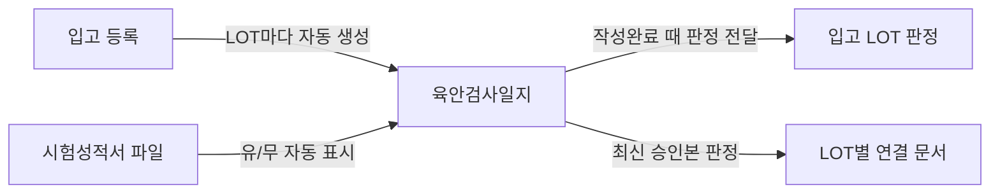
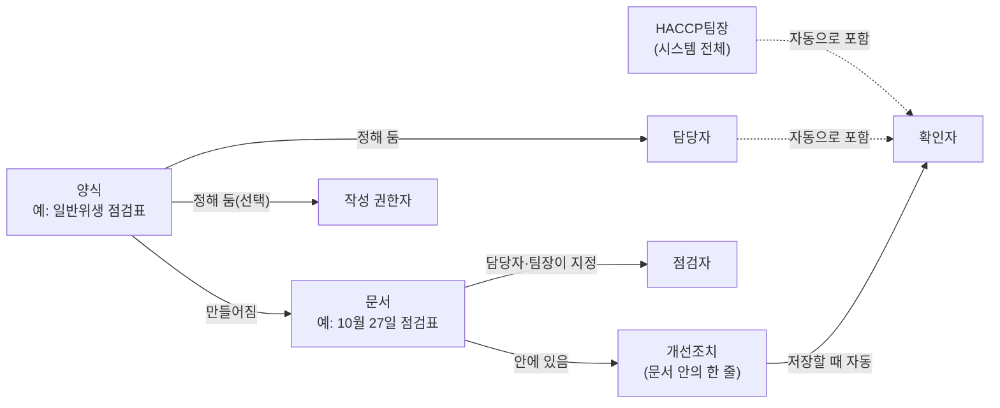

# 문서·결재 기능 안내

문서함·결재함·CCP 대시보드에서 쓰는 기능을 **하고 싶은 일** 기준으로 하나씩 설명합니다. [사용 안내](../user-guide.md) 5장이 문서 업무 순서를 짧게 보여 준다면, 이 문서는 기능마다 누가 쓸 수 있는지, 무엇이 먼저 필요한지, 막힐 때 화면에 무엇이 보이는지, 쓰고 나면 무엇이 바뀌는지를 자세히 적습니다. 입고·재고·생산 화면은 [입고·재고·생산 기능 안내](inventory-guide.md)를 봅니다.

> 현재 기준 2026-10-28 · 코드 기준 `2234f02` · 확인한 `origin/main` `c011126`(문서만 변경) · 작성 중 — "작성 예정"은 아직 쓰지 않은 부분입니다.

## 다른 전달 자료와의 관계

| 알고 싶은 것 | 먼저 볼 문서 | 이 문서에서 더 보는 곳 |
|---|---|---|
| 무엇을 만들었고 어떤 결정이 있었나 | [프로그램 개요](../overview.md) | — |
| 문서 업무의 기본 순서 | [사용 안내](../user-guide.md) 5장 | 2~7장 기능별 사용법 |
| 설치와 처음 업무 설정 | [설치·배포 안내](../installation.md) | 1장 처음 시작하기 |
| 아직 확인하지 않은 것 | [남은 작업](../remaining-work.md) | 각 기능의 "알아둘 점" |
| 기능을 고칠 때 볼 파일·API | [기술 인수인계](../developer-guide.md) | 각 기능 끝의 구현 지도(`reference/features/`)·[API 명세](../api/README.md) |

## 읽는 법

- 기능마다 같은 틀입니다: 언제 쓰나 → 누가 할 수 있나 → 미리 필요한 것 → 사용 순서 → 이럴 때 막혀요 → 하고 나면 바뀌는 것 → 알아둘 점.
- **[테스트 버전]** 표시는 지금 버전에만 해당하는 내용입니다(예: 로그인 없음).
- **관리자 참고** 상자는 설정 파일·명령·오류 코드처럼 설치·운영 담당자가 보는 내용입니다.
- 기능 끝의 작은 글씨 줄에 기능 ID(`F-WF-01` 등)가 있습니다. 같은 ID로 구현 지도와 API 명세를 찾습니다.
- 문서와 화면이 다르면 화면(현재 코드)이 기준입니다. 다른 점은 [남은 작업](../remaining-work.md)에 알려 주세요.

## 목차

| 장 | 내용 | 기능 ID |
|---|---|---|
| 1 | [처음 시작하기](#1-처음-시작하기) · 작성 예정 | `F-ONB` |
| 2 | [문서 작성·수정·작성완료](#2-문서-작성수정작성완료) | `F-DOC` |
| 3 | [결재](#3-결재) | `F-WF` |
| 4 | [CCP·개선조치](#4-ccp개선조치) | `F-CCP` |
| 5 | [입고·생산이 만드는 문서](#5-입고생산이-만드는-문서) · 작성 예정 | `F-REQ` |
| 6 | [출력](#6-출력) | `F-PRT` |
| 7 | [생산일지](#7-생산일지) · 작성 예정 | `F-PLG` |
| 8 | [지원 문서(양식별)](#8-지원-문서양식별) | 양식 코드 |
| 9 | [용어집](#9-용어집) | — |
| 10 | [역할과 권한표](#10-역할과-권한표) · 작성 예정 | `F-ROLE` |

---

## 1. 처음 시작하기

작성 예정 — 직원·역할 설정·양식 설치·주기 점검표 자동 생성을 마치고 첫 문서를 쓰기까지의 순서. 설치 명령은 [설치·배포 안내](../installation.md)의 "최초 업무 설정"에 있고, 여기서는 업무 준비 순서만 다룹니다.

---

## 2. 문서 작성·수정·작성완료

문서를 찾고, 쓰고, 작성완료하는 방법입니다. 결재에 올리는 것은 [3장](#3-결재), 양식별 칸은 [8장](#8-지원-문서양식별)을 봅니다.

**들어가는 곳**: 사이드바 **문서함** · **결재함** · **CCP 대시보드** · **역할 보기** · **생산 기준정보**. 문서함·결재함·CCP 대시보드의 자리는 서버 설정에 따라 **HACCP 관리** 섹션 맨 위 또는 **개발 검증 (임시)** 섹션입니다. 메뉴 옆 숫자는 문서함 = 작성 필요 전체, 결재함 = 내가 처리할 결재, CCP 대시보드 = 내 확인 대기입니다.

**현재 사용자**: **[테스트 버전]** 로그인이 없습니다. 화면 오른쪽 위 **현재 사용자**("이름(코드) · 역할 요약")를 고르면 그 사람으로 기록됩니다. 고르지 않으면 쓰기 버튼(작성·상신·승인 등)이 꺼집니다. 고른 사람은 새로 고쳐도 유지됩니다(브라우저 탭 단위).

| 하고 싶은 일 | 기능 |
|---|---|
| [오늘 써야 할 문서 찾기](#21-오늘-써야-할-문서-찾기) | `F-DOC-01` |
| [지난 문서 찾기](#22-지난-문서-찾기) | `F-DOC-02` |
| [문서를 쓰고 저장하기](#23-문서를-쓰고-저장하기) | `F-DOC-03` |
| [다 쓴 문서를 작성완료하기 · 다시 고치기](#24-작성완료와-작성-재개) | `F-DOC-04` |
| [점검자 정하기](#25-점검자-정하기) | `F-DOC-05` |
| [필요 없는 문서 정리하기(삭제·작성 안 함)](#26-삭제와-작성-안-함) | `F-DOC-06` |
| 증빙 파일 올리기·연결 끊기 | `F-DOC-07` → [8.1 시험성적서](#81-시험성적서-d01) |

---

### 2.1 오늘 써야 할 문서 찾기

| | |
|---|---|
| **언제 쓰나** | 하루를 시작할 때, 쓸 문서가 남았는지 볼 때 |
| **누가 할 수 있나** | 누구나(보기). 쓰기는 작성 권한이 있을 때([9.1](#91-사람과-역할)) |
| **미리 필요한 것** | 없음 |

#### 사용 순서

1. **문서함** → **작성 필요** 탭(기본 탭)을 엽니다. 기준일은 오늘이며 바꿀 수 있습니다(미래 불가).
2. **오늘**(D10·D12 점검표와 그날 입고·생산 문서)·**주간**(그 주 D11) 칸에서 줄의 **[열기]**를 누릅니다.
3. 점선 배지 **문서 없음** 줄은 규칙상 만드는 날인데 아직 문서가 없는 줄입니다. **[만들기]**를 누르면 바로 만들어 작성 화면으로 갑니다.

#### 알아둘 점

- 들어가는 문서는 **작성중·반려·정정 중**입니다. 작성완료·결재중·승인·작성 안 함은 빠집니다.
- **상신 대기** 칸에는 작성완료했지만 아직 결재에 올리지 않은 문서(상신 취소한 것 포함)가 나옵니다.
- **내 문서**: 내가 그 문서의 점검자이거나 그 양식의 담당자·작성 권한자인 줄만 봅니다.
- 칸 아래 "지난 미완료 n건"(최근 30일)을 펼쳐 밀린 문서를 봅니다. 더 오래된 것은 위쪽 빨간 링크로 전체 문서를 엽니다.
- D03은 입고일마다 한 줄(누르면 입고일 묶음), D10 줄에는 `주 항목`(금요일)·`월 항목`(그 달 첫째 월요일) 꼬리표가 붙습니다.
- 주기 규칙 파일이 깨졌으면 노란 줄이 나오고 "문서 없음" 줄만 빠집니다.

`F-DOC-01` · 현재 기준 2026-10-27 · API [`REQ-A08`](../api/document.md#req-a08)

### 2.2 지난 문서 찾기

**사용 순서**: **문서함** → **전체 문서** 탭 → 양식·상태·기간·대상으로 거르기 → **[조회]**.

- 기본 기간은 **최근 7일**입니다. 상태에는 "작성 안 함", "정정 진행 중 전체"도 있습니다.
- **묶음 줄**: D03은 입고일마다, D10·D12는 주(월~금)마다 한 줄로 묶입니다. 누르면 묶음 상세로 갑니다. 주 묶음 줄은 그 주의 가장 늦은 작업일 자리에 놓여, 이번 주 줄이 첫 쪽에 보입니다.
- **[육안검사 오늘]**: 오늘 입고한 D03만 바로 봅니다.
- **[내 담당 양식]**: 내가 담당자인 양식의 문서만 봅니다.

`F-DOC-02` · 현재 기준 2026-10-27 · API [`DOC-A04`](../api/document.md#doc-a04)

### 2.3 문서를 쓰고 저장하기

| | |
|---|---|
| **언제 쓰나** | 점검·측정한 내용을 적을 때 |
| **누가 할 수 있나** | 그 양식의 **담당자·작성 권한자·HACCP팀장**과 그 문서의 **점검자** |
| **미리 필요한 것** | 문서가 **작성중·반려·정정 중**일 것 |

#### 사용 순서

1. 문서 상세 → **[수정]**을 누릅니다.
2. 칸을 채웁니다. 노란색 = 바뀐 칸, 초록색 = 추가한 줄, 취소선 = 지울 줄입니다.
3. **[저장]**을 누릅니다.

#### 이럴 때 막혀요

| 화면에 보이는 것 | 이유 | 이렇게 하세요 |
|---|---|---|
| **[수정]**이 없음 | 작성완료·결재중·승인 상태 | 작성완료면 **[작성 재개]**, 승인이면 정정(`F-WF-05` · 작성 예정) |
| 버튼이 흐리고 이유 한 줄 + **[역할 보기]** | 그 양식의 역할이 없고 점검자도 아님 | 관리자에게 역할을 요청하거나, 담당자에게 점검자 지정을 부탁합니다. |
| "다른 사용자가 먼저 수정했습니다. 최신 내용을 다시 불러오세요." | 화면을 연 뒤 누군가 이 문서를 고침 | 다시 불러온 내용을 보고 고친 뒤 저장합니다. |
| "같은 측정시점이 이미 있습니다." | CCP 일지에서 같은 측정시점을 두 번 넣음 | 재측정이면 재측정으로 표시합니다. |
| "이 영역은 시스템이 채웁니다. 직접 쓸 수 없습니다." | 계산 칸·연동 칸 | 고칠 필요 없습니다. |

#### 하고 나면 바뀌는 것

- **바뀐 줄만** 저장됩니다. 바꾸지 않은 줄의 기록 시각·기록자(CCP 종이의 서명 칸)는 그대로 남습니다.
- CCP 판정·총 건조시간·D03 시험성적서 유무 같은 계산 칸은 서버가 다시 계산합니다.
- 문서 버전이 1 올라갑니다.

#### 알아둘 점

- 저장 때는 **형식만** 검사합니다(숫자 칸에 글자 등). 필수 칸이 비어도 저장되고, 필수 칸은 작성완료 때 검사합니다.
- 승인된 문서를 고칠 때는 정정 절차를 씁니다. **새로 승인되기 전까지는 이전 승인본이 유효**합니다.
- 업무 양식은 모두 입고·생산·날짜에 맞춰 시스템이 만들어서 **[+ 새 문서]** 양식 목록에 나오지 않습니다(주기 점검표는 날짜를 골라 그날 문서를 엶 — [주기 점검표 공통](#주기-점검표-공통)). 목록에 보이는 것은 초기 예시 양식뿐입니다.

`F-DOC-03` · 현재 기준 2026-10-27 · API [`DOC-A07`](../api/document.md#doc-a07) · 결정 D-014, D-021, D-052

### 2.4 작성완료와 작성 재개

| | |
|---|---|
| **언제 쓰나** | 문서를 다 쓰고 결재에 올리기 전. 작성완료한 문서를 다시 고칠 때는 작성 재개 |
| **누가 할 수 있나** | 2.3과 같음 |
| **미리 필요한 것** | 필수 칸·줄 수를 채울 것. 부적합이 있으면 개선조치 1건 이상, D01·D02는 파일 1개 이상 |

#### 사용 순서

1. 문서 상세 → **[작성완료]** → 확인 창 **[작성완료]**.
2. 고칠 것이 생기면 **[작성 재개]**를 누릅니다(확인 창 없음).

#### 이럴 때 막혀요

| 화면에 보이는 것 | 이유 | 이렇게 하세요 |
|---|---|---|
| "작성완료할 수 없습니다. 빠진 항목을 채우세요." + 항목 목록 | 필수 칸·줄 수·양식 규칙 | 목록의 **[수정하러 가기]**·**[개선조치 입력하러 가기]**·**[파일 올리러 가기]**로 이동해 채웁니다. |
| "부적합 항목이 있어 이탈·개선조치를 1건 이상 적으세요" | 부적합 판정이 있는데 개선조치 없음 | [4.1](#41-이탈개선조치-적기) |
| CCP 일지 시작·종료 줄 오류 | 시작 줄이 가장 이르고 종료 줄이 가장 늦어야 함 | 측정일시를 확인합니다. |
| D03: 수불이 판정을 받지 않았다는 LOT별 이유 | 입고 쪽이 판정을 거부 — 작성완료 전체 취소 | 이유를 보고 입고 쪽 상태를 확인합니다. |

#### 하고 나면 바뀌는 것

- 작성완료: 상태 **작성완료**, 문서가 잠기고, **결재에 올릴 수 있게** 됩니다([3.1](#31-문서를-결재-올리기)). 작성완료 시각·사람이 기록됩니다.
- D03은 이 순간 판정(적합·부적합)이 입고 LOT으로 전달됩니다.
- CCP 일지가 아닌 양식의 개선조치는 이때부터 CCP 대시보드 확인 대기에 나타납니다.
- 생산일지는 결재 없이 여기서 끝나고, 기본정보·원료칭량이 이 시점 값으로 고정됩니다([8.7](#87-생산일지-prod-log)).
- 작성 재개: 상태 **작성중**, 작성완료 시각·사람이 지워집니다. 결재중이면 먼저 상신 취소해야 작성 재개할 수 있습니다.

`F-DOC-04` · 현재 기준 2026-10-27 · API [`DOC-A09`](../api/document.md#doc-a09)·[`DOC-A10`](../api/document.md#doc-a10) · 결정 D-054, D-055

### 2.5 점검자 정하기

**사용 순서**: 문서 상세 기본정보 **[점검자 지정]** → 사람 고르기 → 저장. 여러 건은 입고일 묶음·주 묶음에서 줄을 골라 **[점검자 지정 (n)]**.

- 점검자를 바꾸는 것은 그 양식의 **담당자·HACCP팀장**만 합니다. 점검자 본인은 이름만 보입니다.
- 역할이 없는 사람도 점검자가 되면 **그 문서만** 쓸 수 있습니다. 결재에 올리는 것은 역할이 있을 때만 됩니다.
- D03·D10·D11·D12는 점검자가 필수입니다. D03 새 문서는 입고를 등록한 사람이 점검자로 채워집니다.

`F-DOC-05` · 현재 기준 2026-10-27 · API [`DOC-A20`](../api/document.md#doc-a20) · 용어 [점검자](#점검자)

### 2.6 삭제와 작성 안 함

| 하려는 것 | 쓰는 기능 | 조건 |
|---|---|---|
| 잘못 만든 문서를 없애기 | **[삭제]** | 작성중이고 **한 번도 상신하지 않은** 문서. 입고·생산이 만든 문서는 지울 수 없음 |
| 휴무 등으로 쓸 일이 없는 날 | **[작성 안 함]**(사유 필수) | 주기 점검표(D10·D11·D12)의 작성중 문서만 — [주기 점검표 공통](#주기-점검표-공통) |

- 삭제는 기록을 남기는 삭제입니다. 목록에서 사라지지만 DB에는 남습니다.
- 입고·생산 문서는 상세에 "작성 요구로 만들어진 문서입니다. 삭제할 수 없습니다."가 보입니다. 입고를 취소하면 그 LOT의 D01~D03이 함께 정리됩니다([입고·재고·생산 기능 안내 2.3](inventory-guide.md#23-입고-취소)).
- 주기 점검표를 지우면 규칙상 만드는 날에는 다시 만들어지므로, 쓸 일이 없는 날은 삭제 대신 작성 안 함을 씁니다.

`F-DOC-06` · 현재 기준 2026-10-27 · API [`DOC-A08`](../api/document.md#doc-a08)·[`DOC-A24`](../api/document.md#doc-a24) · 결정 D-202

---

## 3. 결재

문서를 결재받고, 결재하고, 결재를 거두거나 승인된 문서를 고치는 방법입니다.

| 하고 싶은 일 | 기능 |
|---|---|
| [다 쓴 문서를 결재 올리기](#31-문서를-결재-올리기) | `F-WF-01` |
| 결재하기(승인·반려) | `F-WF-02` · 작성 예정 |
| 반려된 문서를 고쳐 다시 올리기 | `F-WF-03` · 작성 예정 |
| 올린 결재를 거두기 | `F-WF-04` · 작성 예정 |
| 승인된 문서를 고치기(정정) | `F-WF-05` · 작성 예정 |
| 여러 문서를 한 번에 올리기·승인하기 | `F-WF-06` · 작성 예정 |

---

### 3.1 문서를 결재 올리기

다 쓴 문서를 결재받도록 올립니다. 올리면 문서가 잠기고, 결재할 사람은 자동으로 정해집니다.

| | |
|---|---|
| **언제 쓰나** | 점검표·일지를 다 쓰고 **[작성완료]** 를 누른 뒤. 반려된 문서를 고쳐 다시 올릴 때도 같습니다. |
| **누가 할 수 있나** | 그 양식의 **담당자**, **작성 권한자**, **HACCP팀장**. 내 역할은 **[역할 보기]** 에서 확인합니다. (권한표 · 작성 예정) |
| **미리 필요한 것** | ① 문서가 **작성완료** 상태일 것 ② 그 양식의 결재 칸마다 결재할 사람이 1명 이상 있을 것 (관리자가 역할 설정에서 정함) |

#### 사용 순서

1. 왼쪽 메뉴 **문서함** 에서 문서를 엽니다.
2. 문서 아래 결재 영역에서 **"상신하면 아래 결재선으로 결재가 진행됩니다."** 표를 보고 누가 결재할지 확인합니다.
3. **[결재 상신]** 을 누릅니다.
4. 확인 창(**결재 상신 · 문서 #번호**)의 결재선 표를 다시 보고 **[상신]** 을 누릅니다.

#### 이럴 때 막혀요

| 화면에 보이는 것 | 이유 | 이렇게 하세요 |
|---|---|---|
| "작성완료한 뒤 상신할 수 있습니다." (**[결재 상신]** 버튼 없음) | 아직 작성완료 전입니다. | 문서를 마저 쓰고 **[작성완료]** 를 누릅니다. |
| **[결재 상신]** 이 흐리고 "이 양식의 담당자·작성 권한자나 HACCP팀장만 상신할 수 있습니다." | 지금 사용자에게 그 양식의 역할이 없습니다. | **[역할 보기]** 에서 확인하고, 관리자에게 역할을 요청합니다. |
| "결재 칸을 처리할 사람이 없습니다(역할 보유자 0명)." | 결재할 사람이 지정되지 않았거나 모두 비활성입니다. | 관리자에게 알립니다. |
| "역할 설정 파일 오류로 이 작업을 할 수 없습니다." | 역할 설정에 문제가 있어 **모든 결재 올리기가 멈춘** 상태입니다. | 관리자에게 바로 알립니다. |
| "다른 사용자가 먼저 수정했습니다. 최신 내용을 다시 불러오세요." | 화면을 연 뒤 누군가 이 문서를 고쳤습니다. | 화면을 새로 고친 뒤 내용을 확인하고 다시 올립니다. |

#### 하고 나면 바뀌는 것

- 상태가 **작성완료 → 결재중** 으로 바뀌고, 내용을 고칠 수 없습니다.
- 올린 순간의 내용이 그대로 저장됩니다. 결재하는 사람은 이 내용을 봅니다.
- **결재할 사람** = 올린 순간 그 역할을 가진 사람 전부입니다. 칸마다 1명만 처리하면 되고, 칸 사이 순서는 없습니다. 모든 칸이 승인하면 문서가 **승인** 됩니다.
- 결재할 사람의 **결재함** 에 나타납니다.
- 붙인 증빙 파일(시험성적서 등)은 이후 연결을 끊어도 지워지지 않습니다.
- 육안검사일지는 이때 **시험성적서 유무** 가 확정됩니다.

#### 알아둘 점

- 결재선은 고를 수 없고, 올린 뒤 바꿀 수도 없습니다. 거두려면 **[상신 취소]** 를 씁니다(`F-WF-04`).
- 올린 사람도 자기 칸을 결재할 수 있습니다. 담당자이면서 HACCP팀장인 사람은 두 칸을 각각 처리합니다.
- 올린 뒤 역할이 바뀌어도 이번 결재자는 그대로입니다. 다시 올릴 때는 그때 설정으로 새로 정해집니다.
- **[테스트 버전]** 로그인이 없어서, 역할은 막는 장치가 아니라 실수를 막는 표시입니다. 화면 오른쪽 위 **현재 사용자** 에서 고른 사람으로 처리됩니다. 고르지 않으면 **[결재 상신]** 이 꺼집니다.

> [!NOTE]
> **관리자 참고**
> - 역할과 결재 칸은 역할 설정 파일에서 정합니다([설치 안내 — 역할 설정](../installation.md#역할-설정결재선)). 운영은 `.env.production`의 `HACCP_ROLES_FILE`, 기본값은 `backend/apps/staff/roles.json`(가상 직원만 있음). 파일을 바꾸면 **서버를 다시 시작** 해야 반영됩니다. 직원 등록·비활성은 바로 반영됩니다.
> - 설정 점검: `python backend/manage.py check` — 형식 오류는 `document_workflow.E002`, 처리할 사람이 없는 칸은 `W002`.
> - **문서함** 메뉴 위치는 `HACCP_DOC_MENU`로 정합니다(`haccp`: HACCP 관리 섹션, `dev`: 개발 검증 섹션 — 기본값 `dev`, QA 서버는 `haccp`).
> - 오류 코드: `ROLE_REQUIRED`(403) · `NO_APPROVAL_LINE`(409) · `ROLE_CONFIG_INVALID`(409) · `VERSION_CONFLICT`(409)

`F-WF-01` · 현재 기준 2026-10-27 · 관련 `F-ROLE-01` `F-WF-02` `F-WF-04` · 결정 D-182, D-198 · 구현 지도 [approval.yaml](../../reference/features/approval.yaml)

---

## 4. CCP·개선조치

기준을 벗어난 기록에 무엇을 했는지 적고, 확인하고, 하루 CCP 상황을 보는 방법입니다.

| 하고 싶은 일 | 기능 |
|---|---|
| 오늘 CCP 상황 보기 | `F-CCP-01` · 작성 예정 |
| [기준을 벗어난 기록에 개선조치 적기](#41-이탈개선조치-적기) | `F-CCP-02` |
| [적힌 개선조치 확인하기](#42-개선조치-확인하기) | `F-CCP-03` |

---

### 4.1 이탈·개선조치 적기

기준을 벗어난 측정(**이탈**)에 대해 무엇을 했는지 적습니다. CCP 일지뿐 아니라 **모든 양식**에 있습니다.

| | |
|---|---|
| **언제 쓰나** | CCP 측정값이 한계기준을 벗어났을 때 · 점검표에 X(불량)가 있을 때 · 육안검사가 부적합일 때. 부적합 판정이 있는 문서는 **작성완료 전에 1건 이상** 꼭 적어야 합니다. |
| **누가 할 수 있나** | 그 문서를 쓸 수 있는 사람(양식 담당자·작성 권한자·HACCP팀장·그 문서의 점검자). 이미 적힌 줄을 고치는 것은 그 줄의 [확인자](#확인자)도 할 수 있습니다. |
| **미리 필요한 것** | 없음. 문서 상태와 상관없이 **언제든** 적고 고칠 수 있습니다(승인된 문서도). |

#### 사용 순서

1. 문서 상세 아래 **한계기준 이탈·개선조치** 영역에서 **[+ 추가]** 를 누릅니다.
   - 부적합 줄 옆 **[개선조치 추가]** 나, CCP 대시보드 이탈 표의 **[개선조치 쓰기]** 로 들어가면 그 줄이 관련 행으로 미리 채워집니다.
2. **이탈내용**(필수), **조치자**, **개선조치 및 결과** 를 적습니다.
3. **[저장]** 을 누릅니다.

#### 이럴 때 막혀요

| 화면에 보이는 것 | 이유 | 이렇게 하세요 |
|---|---|---|
| [작성완료] 때 "부적합 항목이 있어 이탈·개선조치를 1건 이상 적으세요" | 부적합이 있는데 개선조치가 없습니다. | 위 순서로 1건 이상 적고 다시 작성완료합니다. |
| 저장 뒤 "확인자를 정하지 못했습니다" | 그 양식에 담당자·HACCP팀장이 없거나 모두 비활성입니다. | 저장은 됐습니다. HACCP팀장이 확인할 수 있습니다. 관리자에게 역할 설정을 알립니다. |
| 대시보드의 **[개선조치 쓰기]** 가 흐림 | 그 양식의 역할이 없습니다. | 점검자는 대시보드가 아니라 **문서 상세** 에서 적습니다. |

#### 하고 나면 바뀌는 것

- **확인자가 자동으로 정해집니다**: 그 양식 담당자 + HACCP팀장(10명까지, 담당자 먼저). 고르는 칸은 없습니다.
- **CCP 대시보드** 의 "② 개선조치 확인 대기"와 사이드바 숫자에 나타납니다. CCP 일지는 적자마자, 다른 양식은 **작성완료 뒤부터** 나타납니다.
- 문서의 버전과 결재 상태는 바뀌지 않습니다.
- 결재에 올린 순간의 개선조치는 그 결재에 함께 남아, 나중에 고쳐도 결재 요청 상세에서 "상신 당시" 내용을 볼 수 있습니다.

#### 알아둘 점

- 확인과 결재는 따로입니다. 확인하지 않아도 결재는 진행됩니다.
- CCP 이탈이나 개선조치를 적어도 생산은 **자동으로 보류되지 않습니다.** 보류·해제는 생산 화면에서 따로 합니다([사용 안내 4장](../user-guide.md#4-보류와-해제) · [개요 — 생산 보류와 문서 결재](../overview.md#생산-보류와-문서-결재는-각각-처리합니다)).
- 조치자는 비워 둘 수 있습니다.

> [!NOTE]
> **관리자 참고**
> - 확인자는 `deviation_checker` 표에 저장됩니다. 지정할 사람이 0명이면 응답에 `checker_warning`이 붙습니다.
> - 결정: D-049, D-054, D-055, D-199, D-202, D-205

`F-CCP-02` · 현재 기준 2026-10-27 · 관련 `F-CCP-03` `F-DOC-04` · 용어 [확인자](#확인자) · 옛 위치: 사용설명서 2.5

---

### 4.2 개선조치 확인하기

적힌 개선조치를 확인자가 보고 **[확인]** 합니다. 결재와는 별개입니다.

| | |
|---|---|
| **언제 쓰나** | 사이드바 **CCP 대시보드** 에 숫자가 보일 때(내가 확인할 개선조치 수) |
| **누가 할 수 있나** | 그 줄의 확인자 중 1명, 또는 HACCP팀장(확인자가 없는 줄도) |
| **미리 필요한 것** | 개선조치가 저장돼 있을 것. 고친 내용을 저장하지 않았으면 먼저 저장하라고 안내합니다. |

#### 사용 순서

1. **CCP 대시보드** 의 "② 개선조치 확인 대기" 또는 배치 영역의 이탈 표에서 **[확인]** 을 누릅니다. 문서 상세의 **확인** 칸에서도 됩니다.
2. 확인 창에서 대상·이탈·조치를 보고 **[확인]** 을 누릅니다.

#### 이럴 때 막혀요

| 화면에 보이는 것 | 이유 | 이렇게 하세요 |
|---|---|---|
| "이미 확인되었습니다(이름, 시각)" | 다른 확인자가 먼저 확인했습니다. | 할 일 없음 |
| "다른 사용자가 먼저 처리했습니다" | 그사이 개선조치 내용이 바뀌었습니다. | 화면이 다시 불러와집니다. 바뀐 내용을 보고 다시 확인합니다. |
| "확인자나 HACCP팀장만 확인할 수 있습니다" | 확인자에서 빠졌거나 처음부터 아닙니다. | [역할 보기](#91-사람과-역할)에서 확인합니다. |
| "삭제된 개선조치입니다" | 그사이 개선조치나 문서가 삭제됐습니다. | 할 일 없음 |

#### 하고 나면 바뀌는 것

- 그 줄이 **확인됨(누가 · 언제)** 으로 바뀌고, 확인 대기 숫자에서 빠집니다.
- **되돌릴 수 없습니다.** 확인한 뒤 내용을 고쳐도 확인 기록은 남습니다.

#### 알아둘 점

- 확인하지 않아도 결재는 올리고 승인할 수 있습니다.

`F-CCP-03` · 현재 기준 2026-10-27 · 관련 `F-CCP-01` `F-CCP-02` · 옛 위치: 사용설명서 1.5.4

---

## 5. 입고·생산이 만드는 문서

작성 예정 — 입고하면 생기는 문서(D01·D02·D03) · 생산을 시작하면 생기는 CCP 일지 · LOT·배치별 연결 문서 · 입고일 묶음 · 주기 점검표(D10·D11·D12)와 주 묶음 · 작성 필요 목록.

---

## 6. 출력

종이 양식 그대로 인쇄하거나 PDF로 저장합니다.

| | |
|---|---|
| **언제 쓰나** | 결재받은(또는 작성완료한) 문서를 종이로 보관·제출할 때 |
| **누가 할 수 있나** | 누구나(현재 사용자를 고르지 않아도 열림) |
| **미리 필요한 것** | 문서가 **작성완료·결재중·승인·정정 중**일 것 |

#### 사용 순서

1. 문서 상세 → **[출력]** → 새 탭의 종이 양식을 확인합니다.
2. **[인쇄]**를 누릅니다. PDF는 인쇄 창에서 "PDF로 저장"을 고릅니다.
3. 묶음 종이는 입고일 묶음 **[출력]** · 주 묶음 **[주 출력]** · 문서 목록(양식 = D11) **[월 출력]**에서도 엽니다.

#### 종이 단위

| 종이 | 단위 | 용지 | 여는 곳 |
|---|---|---|---|
| CCP-1P·2B·3P 모니터링일지 | 문서 1건 | A4 세로 | 문서 상세 **[출력]** |
| D03 육안검사일지 | 입고일 하루(쪽당 9줄) | A4 가로 | 문서 상세(그 입고일 종이) · 입고일 묶음 **[출력]** |
| D10·D12 점검표 | 주(월~금 + 출력할 수 있는 주말 문서가 있는 요일) | A4 세로 | 문서 상세(그 주 종이) · 주 묶음 **[주 출력]** |
| D11 방충방서점검표 | 달(그 달 월요일 수만큼 4~5주) | A4 가로 | 문서 상세(그 달 종이) · 문서 목록 **[월 출력]** |
| 생산일지 | 문서 1건(**작성완료만**) | A4 세로, 결재 칸 없음 | 생산일지 머리 **[출력]** |
| D01·D02 첨부 | 파일 원본 그대로(머리·결재 칸 없음) | 사진은 A4 세로 한 쪽에 하나 | 증빙 파일 **[인쇄]**·**[모두 인쇄]** |

#### 이럴 때 막혀요

| 화면에 보이는 것 | 이유 | 이렇게 하세요 |
|---|---|---|
| **[출력]**이 흐리고 "작성완료 뒤 출력할 수 있습니다" | 작성중·반려 | 작성완료합니다. |
| 묶음 종이에서 어떤 줄·칸이 비거나 "미작성"(D03) | 그 문서가 작성중·반려 | 그 문서를 작성완료하면 채워집니다. D10·D12의 미작성·작성 안 함 요일은 현업 합의 전까지 빈칸입니다. |
| **[주 출력]**이 꺼짐 | 아직 오지 않은 주 | — |
| 미래 날짜·달 오류 | 미래 종이는 만들지 않음 | 지난 날짜로 엽니다. |

#### 무엇이 찍히나

- 칸 배치는 기준서 종이 양식 그대로입니다(CCP-3P는 캔디류 양식). 넘치면 다음 쪽에 머리와 표 머리를 반복하고 쪽 번호를 찍습니다.
- **결재 칸에는 승인한 칸만 이름**이 찍힙니다(날짜 없음). 결재중이면 승인한 칸만, 작성완료(상신 전·상신 취소 뒤)면 비어 있습니다. D10·D12·D11 머리 결재 칸은 그 기간에 그 역할로 가장 최근 승인한 사람, D12는 요일마다 그날 결재 칸도 찍습니다.
- **정정 중인 문서는 이전 승인본 값**과 그 결재 칸으로 찍힙니다(정정 표시 없음). 개선조치 표는 늘 지금 값이고, 없으면 빈 줄 2개입니다.
- 서명·확인·조치자 칸은 **이름만**입니다. CCP 서명 칸 = 그 측정 줄을 기록한 사람. 점검자는 D10만 찍습니다(그 주 가장 늦은 요일 문서의 점검자).
- 생산일지는 작성완료 때 고정한 기본정보·원료칭량이 나옵니다.

#### 알아둘 점

- 출력해도 문서·결재 기록은 바뀌지 않고, 출력 기록도 남지 않습니다.
- **원료수불대장은 시스템 결재가 없습니다.** 수불대장 화면에서 출력한 뒤 종이로 따로 결재합니다([입고·재고·생산 기능 안내 3.1](inventory-guide.md#31-수불-내역)).

`F-PRT-01` · 현재 기준 2026-10-27 · API [`WF-A06`](../api/document.md#wf-a06) · 결정 [문서 결정 11장](../../reference/document-decisions.md#11-단위별-진행-p9p15--줄마다-설계구현-상태)

---

## 7. 생산일지

작성 예정 — 생산일지 쓰기(연동 값 불러오기·공정 템플릿 넣기) · 작성완료와 출력 · 공정·공정 템플릿 관리(생산 기준정보).

---

## 8. 지원 문서(양식별)

이 시스템에서 쓰는 문서(양식)입니다. 양식 이름을 누르면 그 문서가 언제 생기고, 누가 쓰고, 어디서 찾고, 누가 결재하고, 어떻게 출력하는지 볼 수 있습니다. 작성·결재처럼 모든 양식에 같은 기능은 [3장 결재](#3-결재)·[4장 CCP·개선조치](#4-ccp개선조치)를 봅니다.

| 언제 생기나 | 양식 | 누가 쓰나 | 결재 | 여러 건 한 번에 | 출력 |
|---|---|---|---|---|---|
| 입고할 때 LOT마다 | [시험성적서 `D01`](#81-시험성적서-d01) | 담당자·작성 권한자 | 담당자 | — | 첨부 원본 |
| 〃 | [원산지 증명/수입면장 `D02`](#82-원산지-증명수입면장-d02) | 담당자·작성 권한자 | 담당자 | — | 첨부 원본 |
| 〃 | [원료/부자재 육안검사일지 `D03`](#83-원료부자재-육안검사일지-d03) | 점검자 | 담당자 + 팀장 | ✓ | 입고일 묶음 |
| 생산을 시작할 때 배치마다 | [CCP-1P 쇳가루 제거](#84-ccp-1p-모니터링일지쇳가루-제거) | 점검자 | 담당자 + 팀장 | — | 1건 |
| 〃 | [CCP-2B 건조](#85-ccp-2b-모니터링일지건조) | 점검자 | 담당자 + 팀장 | — | 1건 |
| 〃 | [CCP-3P 금속검출](#86-ccp-3p-모니터링일지금속검출) | 점검자 | 담당자 + 팀장 | — | 1건 |
| 〃 | [생산일지 `PROD-LOG`](#87-생산일지-prod-log) | 담당자 | 없음 (작성완료로 끝) | — | 1건 (작성완료만) |
| 매일(월~금) | [일반위생관리 및 공정점검표 `D10`](#88-일반위생관리-및-공정점검표-d10) | 점검자 | 작성자 + 팀장 | ✓ | 주 묶음 |
| 매일(월~금) | [공정별 이물관리 점검표 `D12`](#89-공정별-이물관리-점검표-d12) | 점검자 | 담당자 + 팀장 | ✓ | 주 묶음 |
| 매주 | [방충방서점검표 `D11`](#810-방충방서점검표-d11) | 점검자 | 담당자 + 팀장 | ✓ | 월 묶음 |

- "누가 쓰나"는 주로 쓰는 사람입니다. 그 양식의 **담당자**와 **HACCP팀장**은 모든 양식을 쓸 수 있습니다([9.1 사람과 역할](#91-사람과-역할)).
- 결재 칸은 관리자가 역할 설정에서 정합니다. 위 표는 테스트 버전 기본 설정입니다.
- 모든 양식은 입고·생산·날짜에 맞춰 시스템이 만듭니다. [새 문서]로 마음대로 만들 수 없고, 주기 점검표만 날짜를 골라 그날 문서를 열 수 있습니다([주기 점검표 공통](#주기-점검표-공통)).
- 여러 건 한 번에(점검자 지정·상신·승인)는 한 번에 50건까지입니다.
- 출력할 수 있는 상태는 작성완료·결재중·승인·정정 중입니다. 결재 칸에는 승인한 칸만 이름이 찍히고(날짜 없음), 정정 중인 문서는 이전 승인본 값으로 찍힙니다. 출력해도 문서·결재 기록은 바뀌지 않습니다.
- 이 밖에 개발 초기 예시 양식 2개(CCP 가열 모니터링 `CCP_MONITORING` · 위생 점검 `HYGIENE_CHECK`)가 있습니다. [새 문서]로 만들 수 있지만 업무용이 아니며, 계속 둘지는 정해야 합니다.

### 8.1 시험성적서 `D01`

입고 LOT의 시험성적서를 **파일로 보관**합니다. 입고 LOT 하나에 한 건입니다.

| | |
|---|---|
| **언제 생기나** | 입고를 등록할 때 자동으로 (원산지 증빙·육안검사일지와 함께) |
| **누가 쓰나** | 그 양식의 담당자·작성 권한자·HACCP팀장 (점검자 칸 없음) |
| **누가 결재하나** | 담당자 1명 |
| **어디서 찾나** | 문서함 · LOT별 연결 문서 · 육안검사일지의 **[성적서 보기]** / **[성적서 등록하러 가기]** |
| **출력** | 첨부 파일 원본 그대로 (머리·결재 칸 없음) |

#### 쓰는 칸

| 칸 | 쓰는 법 |
|---|---|
| LOT · 품명 · 매입처 · 입고일 | 입고에서 가져오며 고칠 수 없습니다. |
| 비고 | 선택 |
| 증빙 파일 | **1개 이상** 있어야 작성완료할 수 있습니다. PDF·JPG·PNG, 파일당 20MB 이하. 끌어 놓거나 **[📎 파일 선택]** (여러 개 가능) |

#### 같은 성적서를 여러 LOT에

**[이전 파일 불러오기]** 로 같은 양식(D01)에 올린 파일을 품명·매입처·기간(기본 90일)으로 찾아 **연결** 합니다. 파일을 복사하지 않으므로, 연결된 줄에 "다른 문서 n곳과 공유"가 보입니다.

#### 파일 연결 끊기(✕)

- 다른 문서도 쓰는 파일이면 이 문서에서만 빠지고 파일은 남습니다.
- 마지막 연결이면 파일도 지웁니다. 단 **결재에 올린 적 있는 파일은 지우지 않습니다**(결재 기록 증빙).
- 파일을 올리거나 끊을 수 있는 상태는 작성중·반려·정정 중입니다. 작성완료면 **[작성 재개]** 뒤에, 결재중·승인이면 보기만 됩니다.

#### 보기·출력

파일 표 아래 미리 보기 카드에서 사진·PDF를 봅니다. 카드마다 **[인쇄]**, 머리에 **[모두 인쇄]** 가 있습니다. 사진은 A4 세로 한 쪽에 하나, PDF는 원본 그대로 인쇄됩니다. 문서 상태와 상관없이 파일만 있으면 보입니다.

#### 다른 업무와 이어지는 곳

- 같은 LOT 육안검사일지(D03)의 **시험성적서 유/무** 가 이 문서의 파일로 자동 표시됩니다. D03을 결재에 올리는 순간 확정됩니다.
- 입고를 취소하면 함께 삭제 처리됩니다.

#### 알아둘 점

- 작성 권한자는 테스트 버전 기본 설정에만 들어 있습니다. 운영 역할 설정에도 둘지는 확인해야 합니다.

`D01` · 현재 기준 2026-10-27 · 결정 D-058, D-132, D-234 · 관련 API `DOC-A11`~`DOC-A14`

### 8.2 원산지 증명/수입면장 `D02`

입고 LOT의 원산지 증명서 또는 수입면장을 **파일로 보관**합니다. 입고 LOT 하나에 한 건입니다.

| | |
|---|---|
| **언제 생기나** | 입고를 등록할 때 자동으로. 부자재 LOT에도 생깁니다(현업 확인 남음). |
| **누가 쓰나** | 그 양식의 담당자·작성 권한자·HACCP팀장 (점검자 칸 없음) |
| **누가 결재하나** | 담당자 1명 |
| **어디서 찾나** | 문서함 · LOT별 연결 문서 |
| **출력** | 첨부 파일 원본 그대로 (머리·결재 칸 없음) |

#### 쓰는 칸

| 칸 | 쓰는 법 |
|---|---|
| LOT · 품명 · 매입처 · 입고일 | 입고에서 가져오며 고칠 수 없습니다. |
| 서류 종류 | **원산지 증명 / 수입면장** 중에서 고릅니다. 필수 |
| 비고 | 선택 |
| 증빙 파일 | **1개 이상** 필수. 올리기·이전 파일 불러오기·연결 끊기·출력은 [시험성적서](#81-시험성적서-d01)와 같습니다(이전 파일은 D02 파일 안에서만 찾음). |

#### 알아둘 점

- 다른 양식과 주고받는 값은 없습니다. LOT에 연결만 됩니다.
- 입고를 취소하면 함께 삭제 처리됩니다.
- 작성 권한자는 테스트 버전 기본 설정에만 들어 있습니다.

`D02` · 현재 기준 2026-10-27 · 결정 D-058, D-132

### 8.3 원료/부자재 육안검사일지 `D03`

입고된 원료·부자재를 눈으로 검사하고, 받아도 되는지(적합/부적합)를 기록합니다. **입고 LOT 하나에 한 건**입니다.

| | |
|---|---|
| **언제 생기나** | 입고를 등록할 때 자동으로 (시험성적서·원산지 증빙과 함께) |
| **누가 쓰나** | 점검자 (새 문서는 입고를 등록한 사람이 점검자) |
| **누가 결재하나** | 담당자 1명 + HACCP팀장 1명 |
| **어디서 찾나** | 문서함 · 입고일 묶음 · LOT별 연결 문서 |
| **출력** | 입고일 묶음으로 한 장 (A4 가로) |

---

#### 1. 언제 만들어지나

- 입고를 등록하면 그 LOT의 **시험성적서(D01) · 원산지 증빙(D02) · 육안검사일지(D03)** 가 한 건씩 함께 만들어집니다.
- **[새 문서]** 로 직접 만들 수 없습니다. 같은 LOT으로 다시 등록해도 늘어나지 않습니다.
- 입고할 때의 판정에 따라 시작 상태가 다릅니다.

| 입고할 때 판정 | 육안검사일지 |
|---|---|
| **적합** | 검사 항목이 모두 **양호**, 최종판정 **적합** 으로 채워지고 바로 **작성완료** 됩니다. 작성완료가 막히면 작성중으로 남고, 입고는 그대로 진행됩니다. |
| **부적합** 또는 판정 없음 | 빈칸으로 **작성중** 입니다. 점검자가 직접 씁니다. |

부자재 LOT에도 만들어집니다.

#### 2. 작성

##### 쓰는 칸

| 칸 | 쓰는 법 |
|---|---|
| 점검자 | 반드시 있어야 합니다. 새 문서는 입고 등록한 사람으로 채워집니다. 바꾸는 것은 담당자·HACCP팀장만 합니다. |
| 입고 정보 7개 | LOT · 입고일 · 매입처 · 구분 · 품명 · 중량 · 소비기한. 입고에서 가져오며 고칠 수 없습니다. |
| 성상 및 이물혼입 · 외/내포장 · 표시사항 | 양호 / 불량 중에서 고릅니다. 모두 필수입니다. |
| 시험성적서 | **고르지 않습니다.** 같은 LOT의 시험성적서(D01)에 파일이 있으면 "유", 없으면 "무"로 자동 표시됩니다. |
| 최종판정 | 적합 / 부적합 중에서 **직접** 고릅니다. 기본값은 없습니다. 불량 항목이 있는데 적합을 고르면 안내가 나옵니다. |

##### 검사 기준

| 항목 | 기준 |
|---|---|
| 성상 및 이물혼입 | 원료 고유의 색택, 오염·이물 없음 |
| 외/내포장 | 외포장 파손·내부 오염 흔적 없음, 내포장 훼손 없음 |
| 표시사항 | 제품별 표기사항 정확 |
| 파렛트 | 외부오염·파손 없음, 빗물에 젖지 않음 (기준 문구만, 기록 칸 없음) |

##### 부적합일 때

- 최종판정이 **부적합** 이면 **이탈·개선조치를 1건 이상** 적어야 작성완료할 수 있습니다. 없으면 "부적합 항목이 있어 이탈·개선조치를 1건 이상 적으세요"가 나옵니다.
- 개선조치를 쓰는 법은 [4.1 이탈·개선조치 적기](#41-이탈개선조치-적기).

##### 작성완료하면

- 판정(적합/부적합)이 **입고 쪽으로 전달** 됩니다. 입고 쪽이 받지 않으면 작성완료가 취소되고, 화면에 LOT별 이유가 나옵니다.
- 판정을 바꿔 다시 작성완료할 때는 "판정 변경 사유"를 적을 수 있습니다(선택).

##### 시험성적서 바로가기

시험성적서 칸 옆 버튼으로 같은 LOT의 시험성적서로 갑니다.

| 보이는 것 | 뜻 |
|---|---|
| **[성적서 보기]** | 파일이 있습니다. |
| **[성적서 등록하러 가기]** | 파일이 없습니다. 눌러서 올립니다. |
| 회색 안내 | 그 LOT의 시험성적서 문서가 없습니다. |

#### 3. 찾기

| 찾는 곳 | 보이는 것 |
|---|---|
| **문서함** | 다른 문서와 함께 목록에 나옵니다. 같은 입고일 문서는 한 줄로 묶여 보입니다. |
| **입고일 묶음** | 같은 날 들어온 LOT의 육안검사일지를 한 표로 봅니다. 왼쪽부터 LOT → 품목·매입처 → 판정 → 외관·포장·표시·성적서 → 상태 → 결재 → 점검자 → 수량 → 승인본. **부적합 줄은 옅은 붉은 바탕** 입니다. 줄 끝 **[상세]** 로 문서를 엽니다. |
| **LOT별 연결 문서** | 묶음의 LOT 번호를 누르면 그 LOT의 D01·D02·D03과 상태, 최신 승인본의 판정이 나옵니다. |

값을 고치는 것은 **문서 상세에서만** 합니다. 묶음 표에서는 고칠 수 없습니다.

#### 4. 결재

- 결재 칸은 **담당자 1칸 + HACCP팀장 1칸** 입니다. 각 칸에서 1명이 처리하면 되고 순서는 없습니다.
- 결재에 올리는 방법은 공통입니다 → [문서를 결재 올리기](#31-문서를-결재-올리기)
- 올리는 순간 **시험성적서 유무가 확정** 됩니다. 이후 파일을 붙이거나 떼도 결재·출력에 나오는 값은 바뀌지 않습니다. 파일이 없으면 확인 창에 "시험성적서 없음" 경고가 나오지만 그대로 올릴 수 있습니다.
- **여러 건을 한 번에** 할 수 있습니다. 입고일 묶음이나 결재함에서 줄을 골라 **[점검자 지정] · [선택 상신] · [선택 승인]** (한 번에 50건까지). 반려는 한 건씩 합니다.
- 승인된 뒤 고칠 때는 정정 → 작성 예정.

#### 5. 출력

입고일 묶음에서 **[출력]** 을 누르면 그날 육안검사일지가 종이 양식 그대로 A4 가로 한 장으로 나옵니다. 결재 칸은 종이처럼 **기록확인 › 담당자 · 팀장** 으로 표시됩니다.

#### 6. 다른 업무와 이어지는 곳

#### 7. 알아둘 점

- 입고를 취소하면 그 LOT의 시험성적서·원산지 증빙·육안검사일지가 함께 **삭제 처리** 되어 목록·묶음에서 사라집니다(기록은 남음, 결정 D-178). 사용·조정된 LOT이나 결재 상태에 따라 취소가 막힐 수 있습니다([남은 작업 — 기능별 확인](../remaining-work.md#기능별-확인)).
- 판정과 결재는 뜻이 다릅니다. 결재를 승인·반려해도 입고 판정은 바뀌지 않습니다([개요](../overview.md#입고-검사-판정과-결재-승인은-서로-다른-의미입니다)).
- **[테스트 버전]** 입고할 때의 자동 채움은 입고 쪽 코드와 함께 바뀐 기능입니다(10/21~22). 현업 확인이 남아 있습니다.

> [!NOTE]
> **관리자 참고**
> - 양식 정의: `D03_V2`(`backend/apps/documents/seed_forms.py`). 여러 건 처리 대상 양식은 `HACCP_BATCH_TYPES`(기본 `D03,D10,D11,D12`).
> - 입고 쪽이 판정을 받지 않으면 오류 코드 `INVENTORY_REJECTED`.
> - 성적서 유무는 사람이 입력할 수 없는 시스템 칸입니다. 결재 올릴 때 다시 계산해 덮어씁니다.

`D03` · 현재 기준 2026-10-27 · 관련 기능 `F-REQ-01` `F-WF-01` `F-WF-06` `F-PRT-01` · 용어 [점검자](#점검자) · 결정 D-084, D-231~D-236 · 데이터 [forms.yaml](../../reference/features/forms.yaml)

### CCP 모니터링일지 공통

8.4~8.6의 CCP 일지 세 가지에 같은 내용입니다.

| | |
|---|---|
| **언제 생기나** | 제조 배치의 **생산을 시작할 때** 배치마다 CCP-1P·2B·3P 한 건씩 자동으로. 포장 배치와 취소된 배치에는 생기지 않습니다. 생산 시작 전(계획) 배치에는 아직 없습니다. |
| **누가 쓰나** | 점검자(문서마다 담당자·HACCP팀장이 지정). 담당자·HACCP팀장도 쓸 수 있습니다. |
| **누가 결재하나** | 담당자 1명 + HACCP팀장 1명 |
| **어디서 찾나** | 문서함 · **CCP 대시보드**(그 배치 영역) · 생산 화면 배치의 **[연결 문서]** 탭(상태·최근 측정·이탈 수) |
| **출력** | 문서 한 건씩, A4 세로. 기준서 종이 양식 그대로(3P는 캔디류 양식) |

- **기본정보**: 품명·중량(kg)은 배치에서 가져오며 고칠 수 없습니다. **점검자** 는 반드시 있어야 합니다.
- **측정 기록**: 한 줄이 한 번의 측정입니다. 2줄 이상 48줄까지. **첫 줄과 마지막 줄의 측정시점은 고정**(시작·종료)이고, 그 사이에 "작업 중" 줄을 넣습니다.
- **판정은 자동** 입니다. 값을 넣는 즉시 한계기준으로 계산해 보여 주고 서버가 저장합니다. 직접 고를 수 없습니다.
- **부적합 줄이 있으면** 작성완료 전에 개선조치를 1건 이상 적어야 합니다([4.1](#41-이탈개선조치-적기)). CCP 일지의 개선조치는 **적자마자** CCP 대시보드 "② 개선조치 확인 대기"에 나타납니다.
- 이탈이 있어도 생산은 **자동으로 보류되지 않습니다.** 보류·해제는 생산 화면에서 따로 합니다([사용 안내 4장](../user-guide.md#4-보류와-해제)).
- 출력의 서명 칸에는 **그 측정 줄을 기록한 사람** 이름이 찍힙니다.
- 생산일지(`PROD-LOG`)의 CCP 공정은 이 일지의 결과 값을 **[CCP 일지 값 가져오기]** 로 가져갑니다([8.7](#87-생산일지-prod-log)).

### 8.4 CCP-1P 모니터링일지(쇳가루 제거)

쇳가루 제거 공정의 **자력**과 **자석봉 청소** 상태를 기록합니다.

| 칸 | 쓰는 법 |
|---|---|
| 측정시점 | 작업시작 전(첫 줄 고정) · 작업 중 · 작업종료 후(마지막 줄 고정) |
| 측정일시 | 필수 |
| 자력(G) | 필수. 가우스미터로 잰 값 |
| 자석봉 청소 | O / X. 필수 |
| 판정 | 자동 — 자력 **8,000G 이상** 이고 청소 **O** 면 적합, 아니면 부적합 |
| 비고 | 선택, 200자 |

**관리기준** (화면 위 안내와 같음)

| | |
|---|---|
| 한계기준 | 자력 8,000 가우스 이상 · 자석봉 청소상태 확인 · 자석봉 Φ42.7 사용 · 분말 투입량 분당 1kg, 3530rpm 고정 · 금속이물(쇳가루) 10mg/kg 이하 |
| 주기 | 작업 시작 전(자력 측정·자석봉 청소상태 확인), 작업 중 1시간마다 자석봉 청소 |
| 방법 | 가우스미터로 자력 측정, 자석봉 청소. 공정품은 식품공전 금속성이물 시험법으로 검사. 가우스미터는 연 1회 검·교정 |

`CCP-1P` · 현재 양식 v3 · 현재 기준 2026-10-27

### 8.5 CCP-2B 모니터링일지(건조)

건조 공정의 **온도** 와 **총 건조시간** 을 기록합니다.

| 칸 | 쓰는 법 |
|---|---|
| 측정시점 | 건조시작 전(첫 줄 고정) · 작업 중 · 건조종료 전(마지막 줄 고정) |
| 측정일시 | 필수 |
| 건조온도(℃) | 필수. 건조기 판넬 온도 |
| 온도 판정 | 자동 — **68~72℃**(70℃ ± 2℃)면 적합 |
| 총 건조시간 | 자동 — 건조시작 전 줄과 건조종료 전 줄의 측정일시 차이. 시간·분으로 표시 |
| 시간 판정 | 자동 — **115~125분**(2시간 ± 5분)이면 적합 |
| 비고 | 선택, 200자 |

- 온도 판정과 시간 판정 중 **하나라도 부적합** 이면 그 줄은 부적합입니다.
- 측정이 다음 날까지 이어지면 출력의 작성일자가 "~ 마지막 측정일"로 찍힙니다.

**관리기준**: 한계기준 건조온도 70℃ ± 2℃, 총 건조시간 2시간 ± 5분 · 주기 건조 시작 전, 작업 중, 건조 종료 전

`CCP-2B` · 현재 양식 v3 · 현재 기준 2026-10-27

### 8.6 CCP-3P 모니터링일지(금속검출)

금속검출기의 **감도 확인** 과 **제품 통과** 결과를 기록합니다. 종이는 캔디류 양식입니다.

**금속검출기 감도 모니터링** (한 줄 = 한 번의 감도 확인, 2~48줄)

| 칸 | 쓰는 법 |
|---|---|
| 구분 | 시작(첫 줄 고정) · 중간 · 종료(마지막 줄 고정) |
| 통과시간 | 필수 |
| Fe만 통과 · STS만 통과 · 제품만 통과 · Fe+제품 통과 · STS+제품 통과 | 각각 **○(검출) / X(불검출)**. 모두 필수 |
| 판정 | 자동 — 시편이 든 4가지는 **○**, 제품만 통과는 **X** 일 때 적합 |

**금속검출기 제품 통과** (1~10줄)

| 칸 | 쓰는 법 |
|---|---|
| 품명 | 선택 |
| 통과량 · 검출량 | 필수. **검출량이 0보다 크면** 부적합 |
| 특이사항 | 선택 |

**관리기준** (화면 위 안내와 같음)

| | |
|---|---|
| 한계기준(기타가공품) | Fe(철) 2.0mmΦ 이상 불검출, SUS(스테인리스) 2.5mmΦ 이상 불검출 |
| 한계기준(캔디류) | Fe 2.0mmΦ 이상 불검출, SUS 2.0mmΦ 이상 불검출 |
| 점검주기 | 작업시작 전, 작업 중 2시간마다, 제품 변경 시, 작업종료 후 |
| 순서 | ① 표준시편 소독 → ② 표준시편만 통과 → ③ 표준시편과 제품 통과 → ④ 제품만 통과 → ⑤ 사용 후 표준시편 소독·보관. 금속검출기는 연 1회 이상 정상작동 확인 |

화면에는 금속 검출 시·감도 이상 시·기계 고장 시의 **개선조치방법** 안내도 함께 나옵니다(문제 발생 시 HACCP팀장에게 보고 후 조치, 일지에 기록 후 HACCP팀장 승인).

`CCP-3P` · 현재 양식 v3(캔디류 양식 내용) · 현재 기준 2026-10-27

### 8.7 생산일지 `PROD-LOG`

제조 배치의 **원료 칭량·공정·작업자** 를 기록합니다. **결재가 없습니다** — 작성중과 작성완료 두 상태만 있습니다.

| | |
|---|---|
| **언제 생기나** | 제조 배치의 생산을 시작할 때 배치마다 한 건 자동으로. **양식을 설치한 뒤부터** 생깁니다([설치 안내 — 생산일지 설치](../installation.md#생산일지-설치생산-기준정보prod-log)). |
| **누가 쓰나** | 역할 설정의 `PROD-LOG` 담당자와 HACCP팀장. 다른 사람은 버튼이 꺼지고 안내가 보입니다. |
| **누가 결재하나** | 없음. 상태 옆에 "결재 없음"이 보입니다. |
| **어디서 찾나** | 문서함 · 생산 화면 배치의 **[연결 문서]**(CCP 일지 표 아래 한 줄) · CCP 대시보드 배치 영역 · CCP 일지 머리의 "생산일지 #n ↗" |
| **출력** | **작성완료한 일지만**, 한 건씩 A4 세로, 결재 칸 없음 |

#### 쓰는 칸

| 묶음 | 내용 |
|---|---|
| 기본정보 | 제조일·LOT·제품명·품목제조보고번호·생산지시량·실생산량. **수불 생산 기록에서 읽어 오며** 고칠 수 없습니다. |
| 작업 전 점검 | 원료 적합라벨 확인 · 칭량도구 검교정·청결 · 작업 로트·제품명 재확인(각각 적합/부적합) + 점검자 |
| 원료칭량 | BOM 줄 순서대로 비율·투입량·사용량(수불 투입 합)·대체 원료·원산지를 읽어 옵니다. 재고 관리 안 하는 원료(정제수 등)는 사용량을 직접 넣습니다. 줄마다 작업자·비고, **[모두 같은 사람]** |
| 공정 | **[템플릿 고르기]** 로 공정 순서를 불러오거나 **[+ 공정 추가]** 로 넣습니다. 공정마다 작업일·작업자·소요기간과 입력 방식에 따른 칸(판정 / 온도·시간 / 수량, 내포장 규격, 외포장 포장재질·소비기한·완제품수량) |

- **CCP 공정**(쇳가루 제거·건조·금속검출기)은 그 배치의 CCP 일지가 있을 때만 넣을 수 있고, 결과 칸은 **[CCP 일지 값 가져오기]** 로만 채웁니다.
- 지금 공정 순서는 **[템플릿으로 저장]** 으로 다음 배치에 다시 쓸 수 있습니다. 공정·템플릿 목록은 사이드바 **[생산 기준정보]** 에서 관리합니다(누구나, 변경 이력 남음).

#### 작성완료와 작성 재개

- **[작성완료]** 할 때 필수 칸과 함께, CCP 공정마다 **그 CCP 일지가 작성완료 이후 상태이고 값이 같은지** 검사합니다. 빠진 것은 맨 위 목록에 나오고, 누르면 그 칸으로 갑니다. 수불 값을 못 읽으면 작성완료할 수 없습니다.
- 작성완료하면 기본정보·원료칭량이 **그 시점 값으로 고정** 됩니다. 이후 수불 값이나 CCP 일지가 바뀌면 노란 줄로 알려 주고, **[작성 재개]** 로 고칩니다.
- 취소된 배치의 생산일지는 읽기 전용입니다.

#### 출력

머리의 **[출력]**(작성완료일 때만). 제품명·LOT·제조일·CCP 공정 순서 · 기본정보 · 점검사항·점검자 · 원료칭량(합계 줄 포함, 넘치면 다음 쪽) · 공정별 결과 · 외포장 순서입니다. 기본정보·원료칭량은 **작성완료 때 고정한 값** 이 나옵니다.

#### 알아둘 점

- 작성 안 함 처리는 없습니다.
- 판정 칸에 부적합을 골랐을 때 개선조치를 꼭 적어야 하는지는 양식 정의에 조건이 없어 **확인 필요** 입니다.

`PROD-LOG` · 현재 기준 2026-10-27 · 결정 D-246~D-256 · 관련 API `PLG-A01`~`PLG-A08`

### 주기 점검표 공통

8.8~8.10의 점검표 세 가지에 같은 내용입니다.

| | |
|---|---|
| **언제 생기나** | 날짜 규칙에 따라 자동으로. D10·D12는 **월~금 하루 한 건**, D11은 **주 한 건**(작업일 = 그 주 월요일). 규칙 시작일 2026-10-12 |
| **누가 쓰나** | 점검자(문서마다 담당자·HACCP팀장이 지정). 담당자·HACCP팀장도 쓸 수 있습니다. |
| **어디서 찾나** | 문서함 **작성 필요** 탭 · 문서 목록에서 양식을 고르면 주(D11은 달) 단위로 묶여 보임 · **주 묶음 상세**(D10·D12) |

- **만드는 방법**: 운영 PC에서 날마다 주기 문서 생성 명령을 예약 실행합니다(오늘 D10·D12와 이번 주 D11을 찾거나 만들고, 이미 있으면 그대로 둠 — [설치 안내 3.1](../installation.md#31-점검표-주기-문서-자동-생성-문서-영역)). 문서함 **[+ 새 문서] › 주기 양식** 에서 날짜를 골라 그날 문서를 열 수도 있습니다. 없으면 **바로 만들어지므로**, 날짜를 잘못 골랐으면 상세에서 [삭제]합니다.
- **결과 고르기**: 결과는 **O / X / 해당 없음** 버튼입니다. 같은 버튼을 다시 누르면 빈칸이 됩니다. 매일 항목은 O / X만 있습니다. **[매일 항목 모두 O]** 는 매일 항목의 빈칸만 O로 채웁니다.
- **미리 채운 값**: 새 문서에는 `미리` 표시가 붙은 값이 있습니다(입고 항목 O, 그날 해당 없는 주·월 항목은 해당 없음). 바꿀 수 있습니다.
- **X(불량)가 있으면** X 줄이 분홍으로 강조되고, 작성완료 전에 개선조치를 1건 이상 적어야 합니다. X 줄의 **[개선조치 추가]** 를 누르면 이탈내용에 "항목 문장 — 불량"이 미리 채워집니다.
- **작성 안 함**: 휴무 등으로 쓸 일이 없는 날은 작성중 문서에서 **[작성 안 함]**(사유 필수 — (휴무)(작업 없음) 빠른 선택 또는 직접 입력, 200자). 회색 배지로 바뀌고 결재에서 빠집니다. **[되돌리기]** 로 작성중으로 돌아가며 써 둔 값은 그대로입니다. 규칙상 만드는 날을 [삭제]하면 다음 생성 때 다시 만들어지므로, 쓸 일이 없는 날은 삭제 대신 작성 안 함을 씁니다.
- **주 묶음 상세**(D10·D12): 월~금 줄로 상태·점검자·점검 결과(O·X·해당 없음·빈칸 수)·판정·결재를 한 표로 봅니다. 여러 날을 골라 **[점검자 지정] · [선택 상신] · [선택 승인] · [작성 안 함]**. 토·일(특근일) 문서는 아래 "주말 문서 n건 별도" 링크로 엽니다.

### 8.8 일반위생관리 및 공정점검표 `D10`

작업장의 **일반위생과 공정** 을 매일 점검합니다.

| | |
|---|---|
| **누가 결재하나** | 담당자 1명(화면·종이 이름 **"작성자"**) + HACCP팀장 1명 |
| **출력** | 주 단위 한 장(월~금 + 출력할 수 있는 주말 문서가 있는 요일), A4 세로. 점검자는 그 주 가장 늦은 요일 문서의 점검자가 찍힙니다. |

**점검 항목 23개** — 점검자(필수)와 함께 씁니다.

| 주기 | 묶음(항목 수) | 결과 |
|---|---|---|
| 매일 작업 전후 | 개인위생 3 · 방충방서 2 · 설비 1 · 공정관리 5 · 청소소독 1 · 점검 1 | O / X |
| 입고 시 | 입고검수 1 | O / X / 해당 없음 (새 문서는 O로 미리 채움) |
| 매주(금) | 방충방서 1 · 청소소독 2 | O / X / 해당 없음 |
| 매월 첫째 월 | 청소 1 · 교육 1 · 검사 1 · 검증 1 | O / X / 해당 없음 |
| 연간 | 용수검사 · 검교정 | **실시일만** 적습니다(선택, 비워도 부적합 아님) |

`D10` · 현재 기준 2026-10-27 · 결정 D-106~D-109, D-136

### 8.9 공정별 이물관리 점검표 `D12`

공정별 **이물 혼입 방지** 를 매일 점검합니다.

| | |
|---|---|
| **누가 결재하나** | 담당자 1명 + HACCP팀장 1명 |
| **출력** | 주 단위 한 장, A4 세로. 머리 결재 칸과 함께 **요일마다 그날 결재 칸** 이 찍힙니다. 점검자 칸은 없습니다. |

| 칸 | 쓰는 법 |
|---|---|
| 공정명 | 필수, 50자. 직접 입력하며 최근 값이 "최근: …"과 목록으로 제안됩니다. |
| 점검자 | 필수 |
| 관리 항목 15개 | 1회/일 · 육안확인 · **O 적합 / X 부적합**. 묶음: 원료 중의 이물혼입 방지 2 · 설비의 청소상태 불량에 의한 이물혼입 방지 2 · 작업자에 의한 이물혼입 방지 3 · 작업 중 이물 혼입 방지 4 · 포장 중 이물혼입 방지 2 · 해충 등의 혼입방지 2 |

`D12` · 현재 기준 2026-10-27 · 결정 D-106~D-109

### 8.10 방충방서점검표 `D11`

청결구역의 **방충·방서** 를 매주 점검합니다.

| | |
|---|---|
| **누가 결재하나** | 담당자 1명 + HACCP팀장 1명. 여러 건은 결재함에서 한 번에 |
| **출력** | 달 단위 한 장(그 달 월요일 수만큼 4~5주), A4 가로. 문서 목록에서 양식 = D11로 거르면 **[월 ▾] + [월 출력]** 이 나옵니다. 점검자 칸은 없습니다. |

| 칸 | 쓰는 법 |
|---|---|
| 점검자 | 필수 |
| 점검일 | 필수. 기본값은 그 주 월요일, 그 주(월~일) 안에서 바꿀 수 있습니다. |
| 점검 항목 9개 | 주/1회 · **양호 O / 상태불량 X**. 묶음: 비행성 해충점검 2 · 비행성 해충 및 설치류 점검 3 · 작업장 외부트랩 및 방역 4 |
| 특이사항 | 선택, 500자 |

`D11` · 현재 기준 2026-10-27 · 결정 D-106~D-109

---

## 9. 용어집

이 시스템에서 쓰는 말을 모았습니다. 같은 말이 업무에서 쓰일 때와 시스템에서 쓰일 때 뜻이 다를 수 있어, **이 시스템에서의 뜻**을 기준으로 적습니다.

### 용어 묶음

| 묶음 | 무엇에 관한 말인가 | 예 |
|---|---|---|
| [사람과 역할](#91-사람과-역할) | 누가 무엇을 할 수 있나 | 담당자, 작성 권한자, HACCP팀장, 점검자, 확인자 |
| 문서와 양식 | 무엇을 쓰나 | 양식, 문서, 작성 요구, 주기 점검표, 증빙 파일 · 작성 예정 |
| 문서 상태 | 문서가 지금 어디까지 왔나 | 작성중, 작성완료, 결재중, 승인, 반려, 정정 중, 작성 안 함 · 작성 예정 |
| 결재 | 결재가 어떻게 진행되나 | 결재선, 결재 칸, 후보, 회차, 유효 승인본, 상신 취소 · 작성 예정 |
| HACCP 현장 | 업무에서 원래 쓰는 말 | CCP, 한계기준, 이탈, 개선조치, 육안검사 · 작성 예정 |
| 입고·재고·생산 | 원료와 제품의 흐름 | LOT, 제조배치, 보류, BOM · 작성 예정 |

---

### 9.1 사람과 역할

역할은 **어디에 붙는지**가 다릅니다. 양식에 붙는 역할은 그 양식으로 만든 모든 문서에 똑같이 적용되고, 문서나 개선조치에 붙는 역할은 그 한 건에만 적용됩니다.

| 역할 | 어디에 붙나 | 누가 정하나 | 할 수 있는 것 | 결재 |
|---|---|---|---|---|
| [HACCP팀장](#haccp팀장) | 시스템 전체 | 관리자(역할 설정) | 모든 양식의 작성·상신·정정 시작·점검자 지정, 모든 개선조치 확인, 남의 상신 취소 | 팀장 칸 결재 |
| [담당자](#담당자) | 양식 | 관리자(역할 설정) | 그 양식의 작성·상신·정정 시작·점검자 지정 | 담당자 칸 결재 |
| [작성 권한자](#작성-권한자) | 양식(선택) | 관리자(역할 설정) | 그 양식의 작성·상신·재상신 | 하지 않음 |
| [점검자](#점검자) | 문서 한 건 | 그 양식의 담당자·HACCP팀장 | 그 문서 작성(특이사항·개선조치 포함) | 하지 않음 |
| [확인자](#확인자) | 개선조치 한 줄 | 시스템이 자동으로 | 그 개선조치 확인·수정 | 결재와 별개 |
| 역할 없음 | — | — | 읽기만 (입고·생산·주기 점검표로 문서가 자동으로 만들어지게 하는 것은 누구나) | — |

#### 담당자

그 **양식**을 책임지는 사람입니다. 양식마다 여러 명을 둘 수 있습니다.

- **"이 문서의 담당자"** 는 따로 정하는 값이 아니라, 그 문서를 만든 **양식의 담당자**를 말합니다. 담당자를 바꾸면 그 양식의 모든 문서에 바로 적용됩니다.
- 결재선에 **담당자 칸**이 있는 양식이면, 담당자 중 1명이 결재합니다.
- 어떤 양식은 이 칸 이름을 다르게 보여 줍니다. 예: 일반위생 점검표(D10)는 **"작성자"** 로 표시됩니다. 뜻은 담당자와 같습니다.

| | |
|---|---|
| **화면에서 보이는 곳** | **역할 보기** 표의 "담당자" 열 · 문서 결재 영역의 결재선 표 · 화면 오른쪽 위 현재 사용자의 역할 요약 |
| **관련 기능** | 결재 올리기 `F-WF-01` · 결재하기 `F-WF-02` · 정정 시작 `F-WF-05` · 점검자 지정 `F-DOC-05` · 역할 보기 `F-ROLE-01` |
| **헷갈리기 쉬운 말** | **작성 권한자**(결재는 안 함) · **점검자**(문서 한 건에만) · **작성자**(D10의 담당자 칸 이름이기도 하고, 문서를 실제로 쓴 사람을 말하기도 함 → [아래](#헷갈리기-쉬운-말)) |

#### 작성 권한자

그 양식의 문서를 **쓰고 결재에 올릴 수만** 있는 사람입니다. 양식마다 선택으로 둡니다.

- 결재 칸 후보가 아니어서 **결재는 하지 않습니다**. 정정 시작·점검자 지정도 하지 않습니다.
- 현장에서 기록만 맡는 사람에게 줍니다. 예: 시험성적서(D01)·원산지 증빙(D02)을 올리는 사람.

| | |
|---|---|
| **화면에서 보이는 곳** | **역할 보기** 표의 "작성 권한자" 열 (마우스를 올리면 "작성·상신 — 결재 칸 후보 아님") |
| **관련 기능** | 결재 올리기 `F-WF-01` · 다시 올리기 `F-WF-03` · 역할 보기 `F-ROLE-01` |
| **헷갈리기 쉬운 말** | **담당자**(결재까지 함) |

#### HACCP팀장

시스템 전체의 책임자입니다. 여러 명을 둘 수 있습니다.

- 모든 양식에서 담당자가 할 수 있는 일을 할 수 있고, 결재선에 **팀장 칸**이 있으면 팀장 중 1명이 결재합니다.
- 다른 사람이 올린 결재를 취소할 수 있습니다.
- 개선조치는 확인자로 지정되지 않았어도 확인할 수 있습니다.
- 담당자이면서 팀장인 사람은 한 결재에서 담당자 칸과 팀장 칸을 각각 처리합니다.

| | |
|---|---|
| **화면에서 보이는 곳** | **역할 보기** 위쪽 "HACCP팀장" 줄 · 결재선 표의 팀장 칸 |
| **관련 기능** | 결재하기 `F-WF-02` · 상신 취소 `F-WF-04` · 정정 시작 `F-WF-05` · 개선조치 확인 `F-CCP-03` |
| **헷갈리기 쉬운 말** | 없음 |

#### 점검자

**문서 한 건**을 실제로 점검하고 기록하는 사람입니다. 그 양식의 담당자나 HACCP팀장이 문서마다 지정합니다.

- 역할이 없는 사람도 점검자로 지정되면 **그 문서만** 쓸 수 있습니다(특이사항·개선조치 포함).
- 결재에 올리는 것은 담당자·작성 권한자·HACCP팀장 역할이 있을 때만 됩니다.
- 육안검사일지(D03)와 주기 점검표(D10·D11·D12)는 머리 부분에 점검자를 반드시 적어야 합니다.

| | |
|---|---|
| **화면에서 보이는 곳** | 문서 기본정보의 "점검자" 칸 · **[점검자 지정]** 버튼 · 입고일 묶음·주 묶음 화면의 일괄 점검자 지정 |
| **관련 기능** | 점검자 지정 `F-DOC-05` · 여러 문서 한 번에 처리 `F-WF-06` |
| **헷갈리기 쉬운 말** | **확인자**(개선조치를 확인하는 사람) · **담당자**(양식에 붙음) |

#### 확인자

**개선조치 한 줄**을 확인하는 사람입니다. 고르지 않고, 개선조치를 저장할 때 **그 양식의 담당자 + HACCP팀장**으로 자동 지정됩니다(최대 10명, 담당자 먼저).

- 확인자 중 1명 또는 HACCP팀장이 **[확인]** 하면 끝납니다. 확인은 결재와 별개이고, 결재를 막지 않습니다.
- 확인한 뒤 내용을 고쳐도 확인 기록은 지워지지 않습니다.
- 지정할 사람이 없으면 저장은 되고 경고가 뜹니다. 이때는 HACCP팀장이 확인합니다("확인자 없음 — HACCP팀장이 확인").

| | |
|---|---|
| **화면에서 보이는 곳** | 개선조치 줄의 "확인자" 표시 · **CCP 대시보드** "② 개선조치 확인 대기"와 "내 확인 대기만" |
| **관련 기능** | 개선조치 쓰기 `F-CCP-02` · 개선조치 확인 `F-CCP-03` · CCP 대시보드 `F-CCP-01` |
| **헷갈리기 쉬운 말** | **점검자**(문서를 쓰는 사람) · **결재자**(문서 전체를 승인하는 사람) |

#### 헷갈리기 쉬운 말

| 말 | 쓰이는 뜻 | 구분하는 법 |
|---|---|---|
| **작성자** | ① 일반위생 점검표(D10)의 담당자 칸 이름 ② 문서를 실제로 쓴 사람 ③ 자동으로 만들어진 문서에서는 "작성 요구(자동)" | 결재선 표 안에 있으면 ①, 문서 목록·기본정보에 있으면 ②·③ |
| **확인** | ① 개선조치 확인(확인자) ② 결재 확인 창의 버튼 | 개선조치 줄에 있으면 ① |
| **결재자** | 결재 칸을 처리하는 사람. 따로 정하는 역할이 아니라 담당자·HACCP팀장 중 그 칸의 후보 | 역할 보기의 "결재 칸" 열을 봅니다 |

> [!NOTE]
> **관리자 참고**
> - 역할은 역할 설정 파일에서만 바꿉니다(`HACCP_ROLES_FILE`, 기본 `backend/apps/staff/roles.json`). 화면 **역할 보기** 는 읽기 전용입니다. 파일을 바꾸면 서버를 다시 시작해야 반영됩니다.
> - 설정 파일의 이름과 화면 이름: `haccp_leaders` = HACCP팀장 · `forms.<양식>.owners` = 담당자 · `writers` = 작성 권한자 · `slots`(`owner` / `owner_leader` / `leader` / `none`) = 결재 칸 구성 · `labels.owner` = 담당자 칸 표시 이름(예: D10 "작성자").
> - 점검자는 문서마다 DB에 저장되고, 확인자는 개선조치 저장 때 DB에 저장됩니다. 역할 설정 파일에는 없습니다.

현재 기준 2026-10-27 · 결정 D-182, D-198, D-199, D-201 · 용어 데이터 [terms.yaml](../../reference/features/terms.yaml)

---

## 10. 역할과 권한표

작성 예정 — 역할 보기 화면 · 역할별로 할 수 있는 일 한 표. 역할의 뜻은 [9.1 사람과 역할](#91-사람과-역할)을 봅니다.
