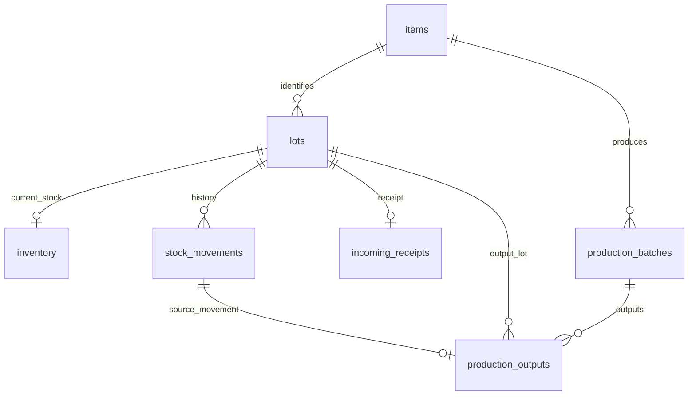

# 2026-10-14 멘토링 반영 전 ERD 점검

회의록과 현재 작업 트리의 SQL·모델·서비스·API·프로토타입을 대조한 정적 검토다. 운영 DB 적용 상태와 실제 데이터는 확인하지 않았다. 기존 작업 파일은 수정하지 않았다. 사용자의 후속 정정에 따라 원료 채번 기준과 소비기한 유무 필드 추가는 확정 요구사항으로 반영한다. 생산 LOT 형식, 반제품에 동일 일자 LOT 통합을 적용할지는 별도 확인 사항이다.

## 확정 요구사항: 원료 채번

- 소비기한이 있는 원료: `품목 약어 + 소비기한` 기준으로 채번한다.
- 소비기한이 없는 원료: `품목 약어 + 입고일` 기준으로 채번한다.
- 어떤 날짜 기준인지 혼동하지 않도록 소비기한 유무를 별도 필드로 관리하고 조회 화면에도 표시한다. 필드 추가 자체는 합의된 요구사항이며, 아래의 구체적인 컬럼명·배치 위치는 ERD 설계 제안이다.
- 소비기한 날짜가 미입력된 것을 소비기한 없는 원료로 자동 판단하지 않는다. '있음'이면 소비기한 날짜를 요구하고, '없음'으로 확인된 경우에만 입고일을 사용한다.
- 모든 원료를 입고일 기준으로 통일하는 대안은 채택하지 않는다. 붙여넣은 회의록의 '원료 채번 미확정' 표기는 사용자의 후속 정정으로 대체한다.

## 현재 관계

`production_outputs`의 FK 자체는 여러 배치가 같은 LOT을 참조할 수 있다. 그러나 작업 중인 0006의 `trg_outputs_one_batch_per_lot` 트리거가 이를 금지한다. 배치당 한 LOT 제한은 별도 트리거다.

## 점검 결과

| 항목 | 현재 구현 | 판단 / 후속 작업 |
|---|---|---|
| 품목 간 LOT 번호 중복 | `lots UNIQUE(item_id, lot_number)` | 이미 지원. 전역 UNIQUE로 변경하지 않는다. 내부 참조는 `lot_id` 유지 |
| 같은 배치의 산출 여러 번 등록 | `add_output`이 기존 배치 LOT에 수불·산출 행 추가 | 지원. 등록 건별 이력과 합산 재고 분리 |
| 서로 다른 배치가 같은 LOT 사용 | 0006 트리거 금지, `add_output`도 기존 번호 거부 | 회의 방향을 적용할 품목유형부터 확정. 적용 시 트리거와 서비스를 함께 변경 |
| LOT별 현재고 | `inventory`는 `lot_id` PK, 수불 INSERT 트리거로 갱신 | 기존 테이블 활용. 새 재고장 테이블 불필요 |
| 개별 수불 기록 | `stock_movements` append-only, 산출별 이동 FK 유지 | 기존 테이블 활용. 정정은 역이동으로 기록 |
| 0 재고 제외 | `lot_stock(include_empty=False)` | 이미 기본 지원 |
| 소비기한 유무 | `lots.expiration_date` nullable | 없음과 미입력 구분 불가. 상태 필드 필요 |
| 원료 반복 입고 | `incoming_receipts.lot_id` UNIQUE, 입고 건마다 LOT 생성 | 소비기한 기반 번호가 반복될 경우 충돌. 입고 건별 접미사 유지 또는 입고 관계 재설계 필요 |
| 채번 순번 제거 | `render()`가 seq 토큰 정확히 1개 요구, `next_lot_number()`는 기존 번호 회피 | 패턴 데이터만 바꿔서는 안 됨. 순번 없는 렌더링과 기존 LOT 재사용 정책 분리 필요 |
| 조회 API | `stock/lots/`, `stock/items/`, `ledger/` 존재 | 신규 전체 구현보다 기존 API 확장. 재고 조회 LOT 번호·제조일 필터, 수불 조회 LOT 번호 검색 등 보완 |
| 화면 | 프로토타입 `inventory.js`가 `HACCP_DATA` 장부 사용 | 기존 탭 활용 여부 검토 후 실제 API 연결. 재고와 수불의 데이터 원천 구분 |

## 소비기한 필드 배치·컬럼 설계 제안

- `items.expiration_policy`: `REQUIRED / NONE / UNKNOWN`. 품목의 기본 관리 정책. 기존 `shelf_life_days/months`는 기간 계산용으로 유지한다. 원료는 소비기한 날짜를 공급처에서 받기도 하므로 기간이 NULL이라는 이유로 NONE으로 판단하지 않는다.
- `lots.expiration_status`: `KNOWN / NONE / UNKNOWN`. 실제 LOT의 등록 상태를 보존. `KNOWN`은 `expiration_date` 필수, `NONE/UNKNOWN`은 날짜 NULL. REQUIRED 정책에서 UNKNOWN 상태의 입고를 허용할지와 사용을 막을지는 별도 결정한다.
- `lots.number_date_basis`: `RECEIVED / MANUFACTURED / EXPIRATION / LEGACY`. 번호 생성에 실제 사용한 날짜 기준. `number_base_date`를 함께 보존하면 기준 정책 변경 이후에도 번호 근거를 확인할 수 있다. 유무 상태와 채번 기준은 서로 다른 의미다.
- 기존 날짜가 있으면 KNOWN, 날짜가 없으면 UNKNOWN으로 이관하는 보수적인 안을 권고한다. NONE은 데이터팀 확인으로 확정한다. 옛 번호의 기준을 모르면 LEGACY로 남긴다.
- Y/N 표시가 필요하면 화면에서 변환하되 UNKNOWN은 '미확인'으로 별도 표시한다. 품목 정책 변경으로 기존 LOT 상태를 일괄 덮어쓰지 않는다.

## 여러 제조배치를 같은 LOT으로 묶을 때의 조건

1. 같은 품목·번호뿐 아니라 LOT 종류, 제조일, 소비기한 상태·날짜가 일치해야 재사용한다. 다른 소비기한을 하나의 `lots.expiration_date`로 덮어쓰지 않는다. 날짜가 다르면 별도 번호를 부여하거나 관리 단위를 다시 설계한다.
2. 산출별 `production_outputs.batch_id`와 `stock_movement_id`를 유지한다. 배치 문서·CCP 기록은 배치 기준으로 추적한다. `v_batch_outputs`·`v_lot_trace`는 연결을 보존하지만 LOT 역추적은 합쳐진 배치의 원료 전체를 보여준다.
3. 배치 HOLD는 공유 LOT 전체의 사용을 막는 결과가 된다. 한 배치 해제 후 다른 배치의 HOLD가 남으면 LOT은 계속 차단되어야 한다. 공유 LOT에 추가 산출을 허용할지도 확인한다.
4. LOT에서 일부 출고·투입했을 때 어느 제조배치 물량이 나갔는지는 현재 수불 구조만으로 확정할 수 없다. 배치별 출고 추적이 필요하면 별도 배분 관계가 필요하다. 화면에서 배치 출처를 임의로 단정하지 않는다.
5. 완제품 동일 일자 LOT 허용을 반제품에 자동 적용하지 않는다. 현재 제조 산출은 SEMI로 제한되어 있고 신규 포장배치는 차단되어 있다. 회의의 완제품 논의와 원료~반제품 MVP 범위를 분리해 적용 대상을 확정한다.

## 원료 채번 주의점

현재 입고는 LOT과 1:1이고 판정·취소·공급처·문서 뷰도 이를 전제로 한다. 확정된 소비기한/입고일 기준으로 채번하되, 동일 원료·동일 기준일의 반복 입고 시 중복 처리 방식은 별도 구현 검토 대상이다. `약어 + 소비기한`만으로 동일 소비기한 입고를 하나로 합치면 공급처, 입고 검사 판정, 입고 취소를 LOT 단위로 처리하는 기존 로직까지 영향을 받는다. 입고 건별 접미사 유지 또는 입고 관계 재설계의 영향을 검토한다. 이는 날짜 기준을 다시 선택하는 문제가 아니다.

현재 FEFO는 날짜 NULL을 뒤로 보내고 `lot.id`순으로 정렬한다. 소비기한 없는 원료를 입고일순으로 선택하려면 `incoming_receipts.received_date`를 명시적인 정렬 기준으로 써야 한다. UNKNOWN의 사용 허용은 NONE과 분리해야 한다.

## 구현 순서 및 검증 조건

1. 확정된 원료 채번 기준과 소비기한 유무 필드를 ERD에 반영한다. 컬럼 배치·기존 데이터 이관·반복 입고 중복 처리를 검토하고, 생산 LOT 통합 적용 품목유형·날짜 형식은 별도로 확인한다.
2. 실제 DB의 마이그레이션 적용 상태와 LOT·배치·산출 데이터를 확인한다. 적용된 스키마는 새 SQL 마이그레이션으로 변경한다. 모델이 `managed=False`라 모델 필드 추가만으로 DB는 바뀌지 않는다.
3. 상태 필드·CHECK·이관을 추가하고 CSV import/seed, 입고·생산·기초재고 서비스, serializer와 문서 뷰를 함께 점검한다. 문서 뷰는 기존 컬럼 계약을 유지하고 필요한 컬럼을 추가한다.
4. 적용 범위에 한해 기존 LOT 재사용·순번 없는 채번을 구현하고 HOLD·추적성을 검증한다.
5. 기존 재고·수불 API에 검색 조건·상태 표시를 추가하고 화면을 연결한다. 수불 날짜는 `occurred_at`, 생산 LOT 검색 제조일은 `manufactured_date`로 구분한다.

필수 검증: 다른 품목 같은 번호 허용 / 같은 품목 다른 배치의 통합 허용 범위 / 500+500-300=700 및 이력 3건 / 재시도 중복 등록 방지 / 다른 소비기한 통합 거부 / NULL의 NONE·UNKNOWN 구분 / 같은 소비기한의 반복 입고 / 공유 LOT의 다중 HOLD·부분 해제 / 배치별 취소·정정 후 다른 배치 재고 보존 / 0 재고 기본 제외·과거 수불 보존.

포장 단위 미확정 상태에서는 `items.base_unit`으로 재고를 관리한다. 박스 수와 개수를 섞어 합산하지 않는다. 박스 환산·포장재 BOM은 단위가 확정된 후 별도 확장한다.

## 확인한 소스

- `backend/apps/inventory/sql/0001_core.sql`: LOT 유일성, 재고·수불, 입고 관계
- `backend/apps/inventory/sql/0002_production.sql`: 산출 FK·추적·문서·수불 뷰
- `backend/apps/inventory/sql/0005_pm_meeting_1014.sql`, `0006_mvp_bulk_scope.sql`: 작업 중 변경
- `backend/apps/inventory/{models,lot_numbers,receiving,production,holds,stock,ledger,api,serializers}.py`
- `frontend/static/prototype/js/modules/inventory.js`, `docs/inventory-decisions.md`

기존 결정 문서는 생산 순번·약어 및 1배치=1LOT 방향을 기록하고 있다. 이번 회의의 적용 범위가 확정되면 문서도 함께 갱신해야 한다.
